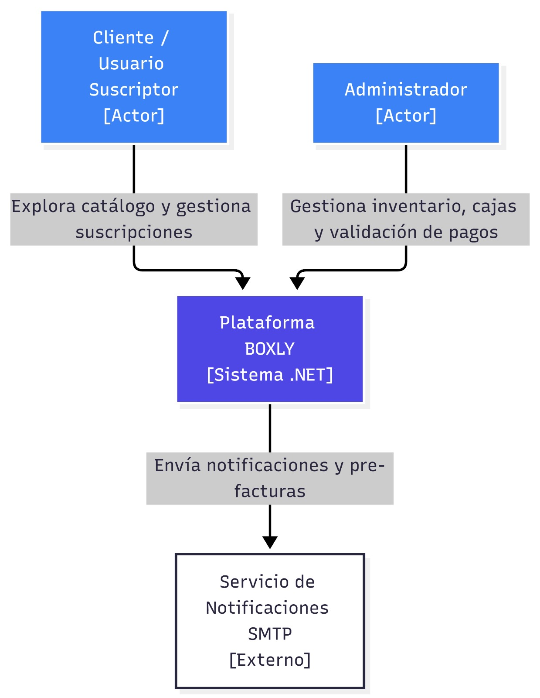
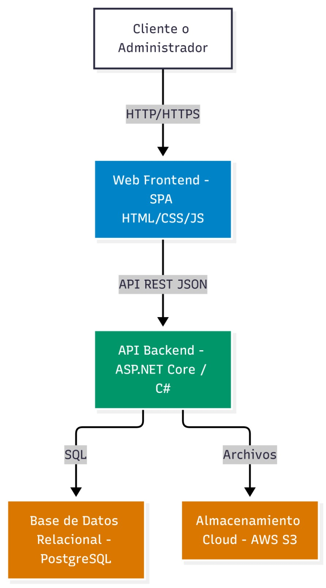
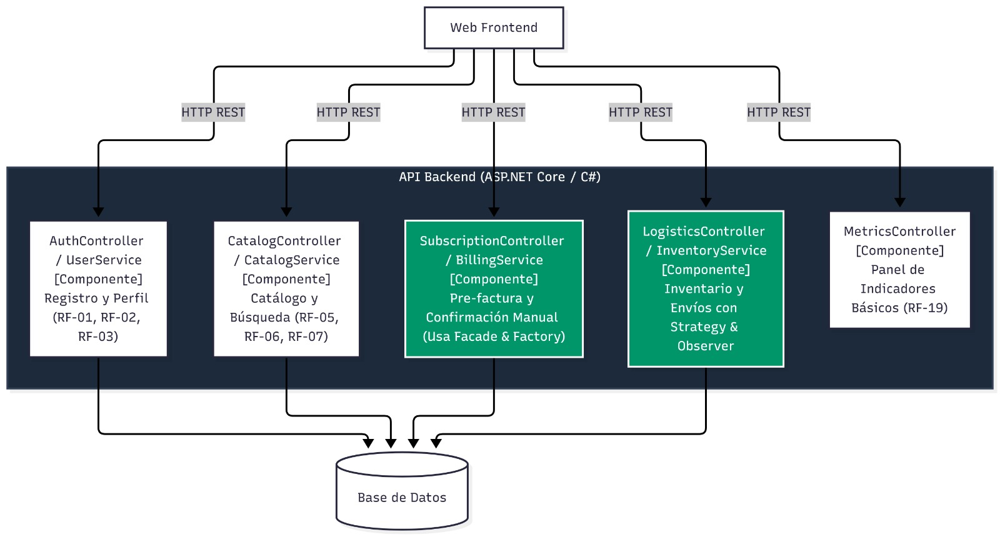
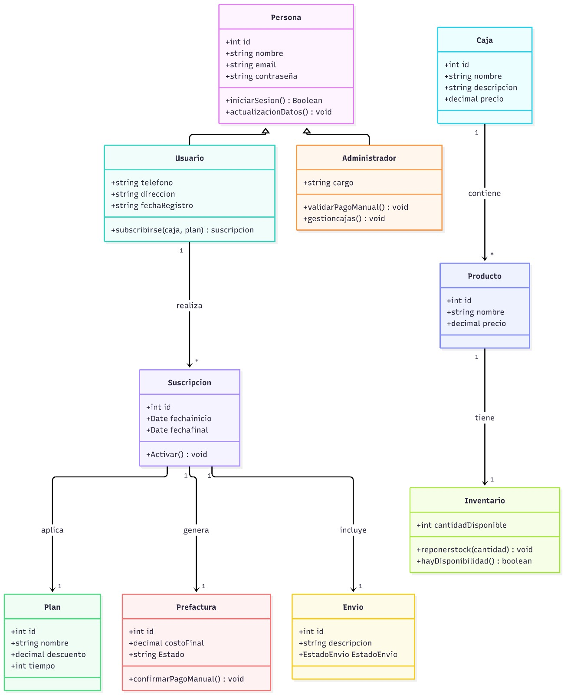

# boxly_entregable_no_2

# BOXLY: Plataforma de Suscripción a Cajas de Productos

## Entregable No. 2 - Diseño de Sistemas de Información

**Institución:** Instituto Tecnológico de Medellín (ITM)

**Facultad:** Ingeniería

**Curso:** Diseño de Sistemas de Información

**Docente:** Alexandra Guerrero Bocanegra

**Fecha:** Octubre de 2026

**Integrantes:**

- Andrés Felipe Orozco Paternina
- Jose Manuel Pulgarin Rueda
- Juan David Restrepo Alvarez
- Jesús David Ávila Arrieta

---

## 1. Refinamiento y Consolidación del Entregable 1 en el Entregable 2

El Entregable No. 2 toma los insumos del Entregable No. 1 (requisitos de usuario, reglas de negocio, story mapping, historias de usuario y diagrama de clases) y los evoluciona hacia una solución técnica orientada a objetos estructurada sobre patrones de diseño y una arquitectura multicapa clara.

### Tabla 1. Matriz de Ajustes Técnicos y Simplificación del Alcance (MVP)

| Elemento Ajustado | Estado Anterior (Entregable 1) | Estado Refinado (Entregable 2) | Justificación Técnica y Operativa |
| --- | --- | --- | --- |
| **Stack Tecnológico Backend** | Propuesta heterogénea/genérica (Node.js/Java). | **ASP.NET Core (.NET / C#)**. | Estandarización de arquitectura, aprovechamiento de Inyección de Dependencias nativa, tipado fuerte y manejo eficiente de datos con Entity Framework Core. |
| **Flujo de Pago y Cobro** | Integración compleja con pasarelas de pago de terceros (MercadoPago / Wompi) vía Adapter. | **Generación de Pre-factura con Confirmación de Pago Manual / Contra Entrega**. | Eliminación de dependencias de SDKs de terceros para el MVP, concentrando la lógica en la emisión de pre-facturas y la aprobación administrativa previa al despacho. |
| **Módulo de Analítica y Reportes** | Dashboard complejo con gráficas dinámicas (RF-19). | **Panel de Indicadores Básicos (Métricas numéricas y tablas resumen)**. | Reducción de sobreingeniería visual en el MVP, garantizando la entrega de métricas clave (usuarios activos, cajas despachadas, ingresos) de forma óptima. |

---

## 2. Arquitectura C4

La arquitectura del sistema **BOXLY** se documenta mediante las cuatro capas del modelo C4, garantizando trazabilidad total con los requisitos y reglas de negocio.

---

### Nivel 1: Diagrama de Contexto del Sistema

Define los límites de la plataforma BOXLY, los roles de usuario que interactúan con ella y los servicios externos de apoyo.

- **Cliente / Usuario Suscriptor:** Explora el catálogo, configura sus preferencias de productos, selecciona planes de suscripción, gestiona sus pre-facturas y hace seguimiento logístico a sus envíos (RU-01, RU-02, RU-03).
- **Administrador del Sistema:** Controla el inventario de productos, parametriza cajas y planes, valida los pagos de las pre-facturas y actualiza el estado de los despachos (RU-04, RU-05).
- **Servicio de Notificaciones SMTP (Externo):** Emite correos automáticos para la entrega de pre-facturas, confirmación de suscripción activa y novedades de envío.

Nivel 1: Diagrama de Contexto

Nivel 1: [https://drive.google.com/file/d/11qa34QNlKgvQn5VAcFhZry3BYY_5CXcm/view?usp=sharing](https://drive.google.com/file/d/11qa34QNlKgvQn5VAcFhZry3BYY_5CXcm/view?usp=sharing)

---

### Nivel 2: Diagrama de Contenedores

Describe las tecnologías que componen la infraestructura de ejecución de BOXLY.

1. **Web Frontend (SPA - HTML5 / CSS3 / JavaScript):** Interfaz cliente ligera y responsiva que renderiza el catálogo, módulo de suscripciones, pre-facturas y panel de control (RNF-08).
2. **API Backend (ASP.NET Core / C#):** Núcleo del sistema que expone servicios RESTful, ejecuta las reglas de negocio (ej. RN-02: restricción de suscripción activa por período) y coordina la persistencia.
3. **Base de Datos Relacional (PostgreSQL):** Repositorio relacional que asegura la integridad de los datos de usuarios, productos, inventarios, pre-facturas y registros logísticos (RNF-06).
4. **Almacenamiento Cloud (AWS S3):** Depósito de objetos para el alojamiento y distribución de las imágenes de las cajas y catálogo de productos.

Nivel 2: Diagrama de Contenedores

Nivel 2: [https://drive.google.com/file/d/1F8uihSVGiQD0Watg1Y7xXa7IRgxZIKy9/view?usp=sharing](https://drive.google.com/file/d/1F8uihSVGiQD0Watg1Y7xXa7IRgxZIKy9/view?usp=sharing)

---

### Nivel 3: Diagrama de Componentes

Muestra la organización modular interna de la **API Backend en ASP.NET Core**:

- **`AuthController` / `UserService`:** Módulo responsable del registro (RF-01), autenticación de usuarios (RF-02), gestión de perfiles (RF-03) y captura de preferencias de consumo (RF-04).
- **`CatalogController` / `CatalogService`:** Administra el catálogo dinámico de cajas (RF-05), búsquedas filtradas por categoría (RF-06) y detalle del contenido (RF-07).
- **`SubscriptionController` / `BillingService`:** Gestiona la selección de planes (RF-09), cálculo automático de pre-facturas (RF-10, RN-03) y confirmación manual de pagos para la activación (RF-11, RN-04). Incorpora el patrón **Facade** y **Factory Method**.
- **`LogisticsController` / `InventoryService`:** Controla las existencias en bodega (RF-16, RN-06), ejecuta la asignación de productos a cajas según preferencias (RN-05) y gestiona la trazabilidad del despacho (RF-13, RN-08). Utiliza los patrones **Strategy** y **Observer**.
- **`MetricsController`:** Procesa y expone las métricas consolidadas del negocio para el panel de administración (RF-19).

Nivel 3: Diagrama de Componentes

Nivel 3: [https://drive.google.com/file/d/1Wj_FnWiLs7r8d934HXdMNLHSaJl7Y4nX/view?usp=sharing](https://drive.google.com/file/d/1Wj_FnWiLs7r8d934HXdMNLHSaJl7Y4nX/view?usp=sharing)

---

### Nivel 4: Código y Clases (Dominio y Patrones)

Representa la estructura estática del modelo de dominio, evidenciando herencias, asociaciones y la aplicación directa de patrones de diseño.

- **Jerarquía de Usuarios:** `Persona` es la clase abstracta padre de `Usuario` y `Administrador`.
- **Ciclo de Suscripción:** La entidad `Suscripcion` vincula a `Usuario` con su `Plan`, la `Prefactura` generada y la orden de `Envio`.
- **Composición de Cajas:** `Caja` agrupa múltiples instancias de `Producto`, los cuales están vinculados directamente a un registro de `Inventario`.

Nivel 4: Diagrama de Clases

Nivel 4: [https://drive.google.com/file/d/1AreANCCpeeQavlo5JtFWH9gMfhxTZlkP/view?usp=sharing](https://drive.google.com/file/d/1AreANCCpeeQavlo5JtFWH9gMfhxTZlkP/view?usp=sharing)

---

## 3. Plantilla de Análisis y Selección de Patrones GoF

Se seleccionaron 5 patrones de diseño orientado a objetos distribuidos en las tres categorías fundamentales de GoF (Creacionales, Estructurales y de Comportamiento), evitando redundancias y resolviendo problemas concretos del MVP.

---

### Patrón 1: Factory Method (Creacional)

- **Propósito en BOXLY:** Desacoplar e independizar la instanciación de los diferentes tipos de planes de suscripción (Plan Mensual, Semestral, Anual).
- **Necesidad en el Sistema (RF-08, RF-17, RN-11):** Cada plan aplica porcentajes de descuento distintos, vigencias en días y condiciones particulares de renovación. Crear los objetos directamente en el controlador genera lógica condicional rígida (`if/switch`) difícil de mantener.
- **Alternativas Consideradas:**
    - *Abstract Factory:* Descartado por sobreingeniería; en el MVP no se requiere crear familias de objetos complejos interrelacionados, solo variantes de una misma jerarquía de planes.
    - *Instanciación Directa (`new PlanMensual()`):* Descartado por violar el principio Open/Closed.
- **Aplicación Concreta:** Se implementa la clase abstracta creadora `SuscripcionFactory` con el método `crearSuscripcion(tipoPlan)`. Las subclases concretas instancian el plan correspondiente con sus reglas de descuento y vigencia configuradas.
- **Validación de No Solapamiento:** Se encarga exclusivamente del **origen de los objetos de suscripción**, sin intervenir en la construcción paso a paso de cajas (Builder) ni en la comunicación de eventos (Observer).

---

### Patrón 2: Builder (Creacional)

- **Propósito en BOXLY:** Permitir la construcción paso a paso de objetos complejos `Caja`, parametrizando productos, cantidades y reglas de empaquetado.
- **Necesidad en el Sistema (RF-04, RF-18, RN-05):** Las cajas no son estáticas; su armado requiere validar disponibilidad en inventario, combinar categorías según preferencias del usuario y calcular el costo total consolidado.
- **Alternativas Consideradas:**
    - *Constructores Telescópicos (múltiples sobrecargas de constructor):* Producen código ilegible y propenso a errores al pasar listas largas de parámetros.
- **Aplicación Concreta:** Se implementa la clase `BoxBuilder` que ofrece métodos fluidos como `.agregarProducto()`, `.aplicarCategoria()`, `.verificarStock()` y `.build()`. Devuelve una instancia válida y consistente de `Caja`.
- **Validación de No Solapamiento:** Resuelve la **construcción progresiva de una entidad compleja**, a diferencia de Factory Method que crea instancias simples de una sola llamada.

---

### Patrón 3: Strategy (Comportamiento)

- **Propósito en BOXLY:** Encapsular y alternar dinámicamente los algoritmos de asignación automática de productos a las cajas de los clientes.
- **Necesidad en el Sistema (RF-04, RN-05, RN-06):** El negocio requiere cambiar la lógica de selección de productos según la estrategia comercial: asignación por coincidencia estricta de gustos del usuario o asignación priorizada por rotación de inventario con alto stock.
- **Alternativas Consideradas:**
    - *Lógica condicional dentro de `CajaService`:* Acopla la clase a múltiples algoritmos, haciendo que cualquier cambio de política exija modificar código existente.
- **Aplicación Concreta:** Se crea la interfaz `IAsignacionStrategy` con el método `armarCaja(usuario, listaProductos)`. Se desarrollan las clases concretas `AsignacionPorPreferenciaStrategy` y `AsignacionPorStockStrategy`, inyectadas en tiempo de ejecución al orquestador.
- **Validación de No Solapamiento:** Maneja **algoritmos de negocio intercambiables**, sin interferir en la creación física del objeto ni en la notificación de cambios.

---

### Patrón 4: Observer (Comportamiento)

- **Propósito en BOXLY:** Desacoplar la notificación de eventos cuando la entidad `Envio` cambia de estado logístico.
- **Necesidad en el Sistema (RF-13, RN-08):** Cuando la caja pasa a estado “Enviada” o “Entregada”, el sistema debe notificar al usuario por correo electrónico y registrar el movimiento en la bitácora de auditoría de forma simultánea.
- **Alternativas Consideradas:**
    - *Llamadas directas desde la clase `Envio` hacia servicios de Email y Log:* Genera un acoplamiento fuerte no deseado entre el dominio logístico y los servicios de infraestructura.
- **Aplicación Concreta:** La clase `Envio` actúa como el sujeto observable (`Subject`). Mantiene una colección de suscriptores que implementan `IEnvioObserver` (`EmailNotifier` y `AuditLogService`). Al cambiar el estado, `Envio` ejecuta `notificarObservadores()`.
- **Validación de No Solapamiento:** Se enfoca estrictamente en la **comunicación pub/sub ante cambios de estado**, diferencándose completamente de los patrones creacionales.

---

### Patrón 5: Facade (Estructural)

- **Propósito en BOXLY:** Ofrecer una interfaz simplificada y unificada para el subsistema de pre-facturación y confirmación de suscripciones.
- **Necesidad en el Sistema (RF-10, RF-11, RN-03):** Generar una pre-factura involucra interactuar con `Plan` (descuentos), `Usuario` (datos fiscales), `Envio` (tarifas de flete) e `Inventario` (reserva de productos). Exponer estas interacciones a la capa de API genera controladores saturados.
- **Alternativas Consideradas:**
    - *Acceso directo desde los controladores REST a múltiples servicios:* Alto acoplamiento entre la capa de presentación y el modelo de negocio.
- **Aplicación Concreta:** Se crea la clase `FacturacionFacade` que expone métodos limpios como `generarPreFactura(usuarioId, planId)`. La fachada coordina internamente las llamadas a los servicios correspondientes y retorna un DTO listo para la vista.
- **Validación de No Solapamiento:** Actúa como **orquestador/punto de entrada simplificado** a un subsistema interno, sin alterar interfaces externas como haría un Adapter.

---

## 4. Plantilla de Análisis de Principios SOLID

---

### S — Single Responsibility Principle (Principio de Responsabilidad Única)

- **Definición:** Una clase debe tener una sola razón para cambiar.
- **Aplicación en BOXLY:**
    - *Diseño previo (Monolítico):* La clase `Suscripcion` realizaba cálculos de planes, guardaba registros en la base de datos y enviaba correos de notificación.
    - *Refinamiento SOLID:* `Suscripcion` conserva únicamente los datos y reglas puras del dominio (fechas y estado). La persistencia se delega a `SuscripcionRepository`, la emisión de comprobantes a `FacturacionFacade` y las notificaciones a `EmailNotifier`.
- **Beneficio:** Un cambio en la infraestructura de correos o en el motor ORM no afecta la entidad de dominio `Suscripcion`.

---

### O — Open/Closed Principle (Principio de Abierto/Cerrado)

- **Definición:** Las entidades de software deben estar abiertas a la extensión pero cerradas a la modificación.
- **Aplicación en BOXLY:**
    - *Aplicación concreta:* Implementado en las estrategias de armar cajas (`IAsignacionStrategy`).
    - *Refinamiento SOLID:* Para agregar un nuevo criterio comercial de empaquetado (ej. *AsignacionPorCajasTematicasStrategy*), no se modifica la clase procesadora existente. Se crea una nueva clase que implementa la interfaz `IAsignacionStrategy`.
- **Beneficio:** Se agregan nuevas reglas de negocio sin riesgo de alterar o romper código previamente testeado en producción.

---

### L — Liskov Substitution Principle (Principio de Sustitución de Liskov)

- **Definición:** Las subclases deben poder sustituir a sus clases base sin alterar el comportamiento correcto del programa.
- **Aplicación en BOXLY:**
    - *Refinamiento SOLID:* La clase abstracta `Persona` define el contrato común de identificación y autenticación (`iniciarSesion()`). Tanto `Usuario` como `Administrador` heredan de `Persona`.
    - *Cumplimiento:* El módulo de seguridad trata cualquier instancia de `Persona` de manera polimórfica sin recurrir a comprobaciones de tipo explícitas (`if (p is Administrador)`), garantizando una ejecución segura y consistente.
- **Beneficio:** Mantiene la solidez del polimorfismo en el control de acceso del sistema.

---

### I — Interface Segregation Principle (Principio de Segregación de Interfaces)

- **Definición:** Los clientes no deben ser obligados a depender de interfaces que no utilizan.
- **Aplicación en BOXLY:**
    - *Diseño previo:* Una interfaz masiva `IGestionSistema` forzaba a los controladores del cliente a conocer métodos administrativos como `actualizarStock()` o `aprobarPagoManual()`.
    - *Refinamiento SOLID:* Se segregó en interfaces específicas por dominio de uso:
        - `IClienteService`: Métodos de catálogo, suscripción y rastreo.
        - `IAdminInventoryService`: Métodos de stock e insumos.
        - `IAdminBillingService`: Métodos de validación de pre-facturas y pagos.
- **Beneficio:** Desacoplamiento total; la interfaz de usuario cliente no depende ni se entera de las operaciones de administración.

---

### D — Dependency Inversion Principle (Principio de Inversión de Dependencias)

- **Definición:** Los módulos de alto nivel no deben depender de módulos de bajo nivel; ambos deben depender de abstracciones.
- **Aplicación en BOXLY:**
    - *Diseño previo:* `BillingService` instanciaba directamente clases concretas de infraestructura para persistencia y notificaciones.
    - *Refinamiento SOLID:* `BillingService` (módulo de alto nivel) depende exclusivamente de la interfaz `INotificationService` y de repositorios abstractos. Las implementaciones concretas se inyectan en tiempo de ejecución utilizando el contenedor de Inyección de Dependencias nativo de **ASP.NET Core** (`IServiceCollection`).
- **Beneficio:** Permite realizar pruebas unitarias con objetos simulados (*Mocks*) y cambiar tecnologías de soporte sin impactar la lógica de negocio.

---

## 5. Repositorio y Entregables

- **Repositorio en GitHub:** [Insertar Enlace al Repositorio de GitHub]
- **Prototipo Figma:** [[https://www.figma.com/community/file/1676053533736794296](https://www.figma.com/community/file/1676053533736794296)]
- **Diagramas Editables:** Nivel 1: [https://drive.google.com/file/d/11qa34QNlKgvQn5VAcFhZry3BYY_5CXcm/view?usp=sharing](https://drive.google.com/file/d/11qa34QNlKgvQn5VAcFhZry3BYY_5CXcm/view?usp=sharing)
- Nivel 2: [https://drive.google.com/file/d/1F8uihSVGiQD0Watg1Y7xXa7IRgxZIKy9/view?usp=sharing](https://drive.google.com/file/d/1F8uihSVGiQD0Watg1Y7xXa7IRgxZIKy9/view?usp=sharing)
- Nivel 3: [https://drive.google.com/file/d/1Wj_FnWiLs7r8d934HXdMNLHSaJl7Y4nX/view?usp=sharing](https://drive.google.com/file/d/1Wj_FnWiLs7r8d934HXdMNLHSaJl7Y4nX/view?usp=sharing)
- Nivel 4: [https://drive.google.com/file/d/1AreANCCpeeQavlo5JtFWH9gMfhxTZlkP/view?usp=sharing](https://drive.google.com/file/d/1AreANCCpeeQavlo5JtFWH9gMfhxTZlkP/view?usp=sharing)