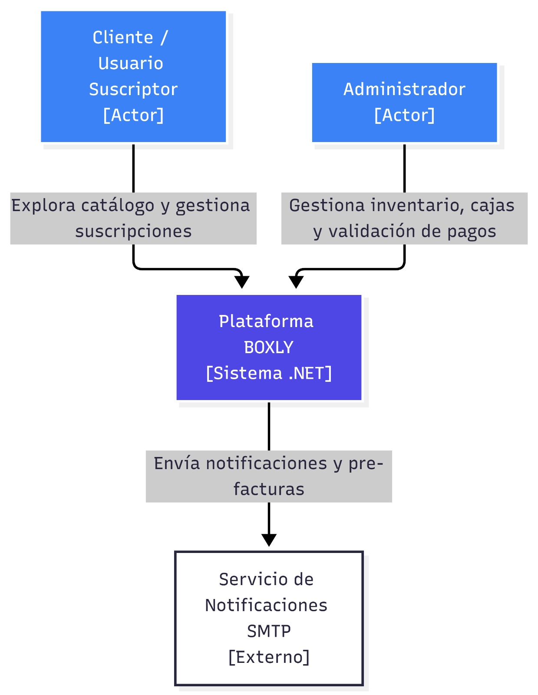
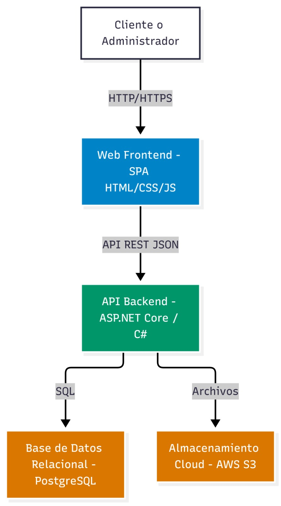
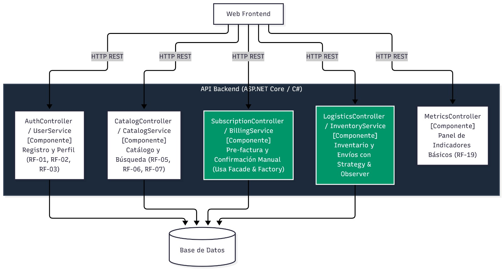
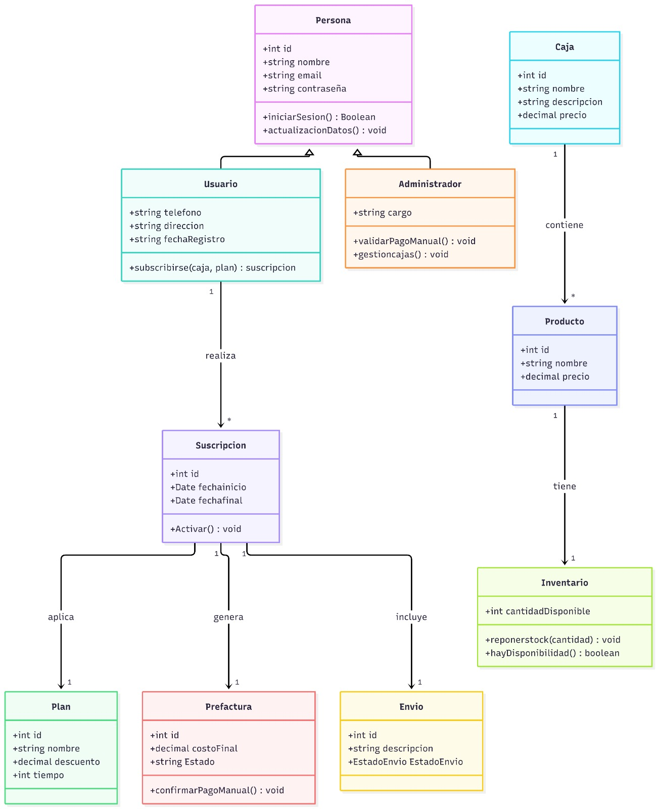
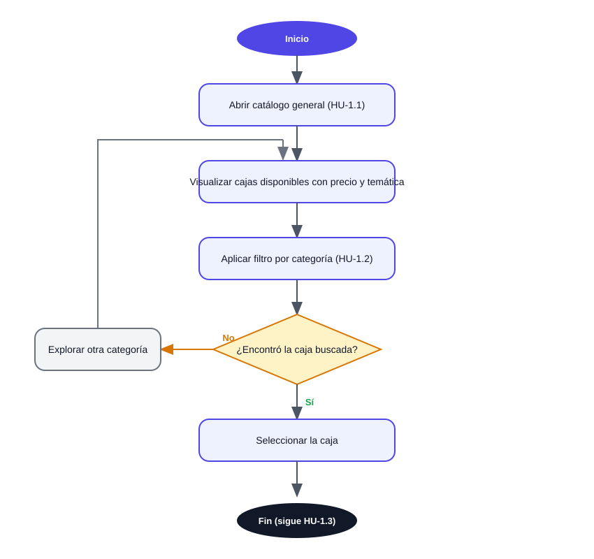
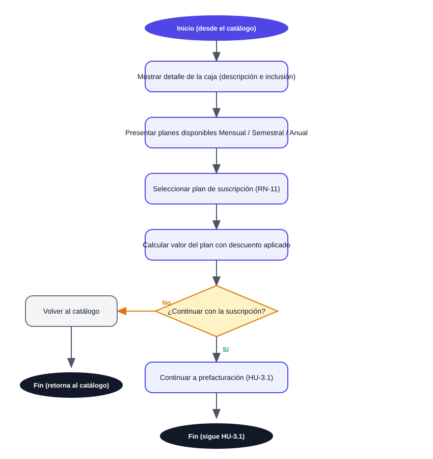
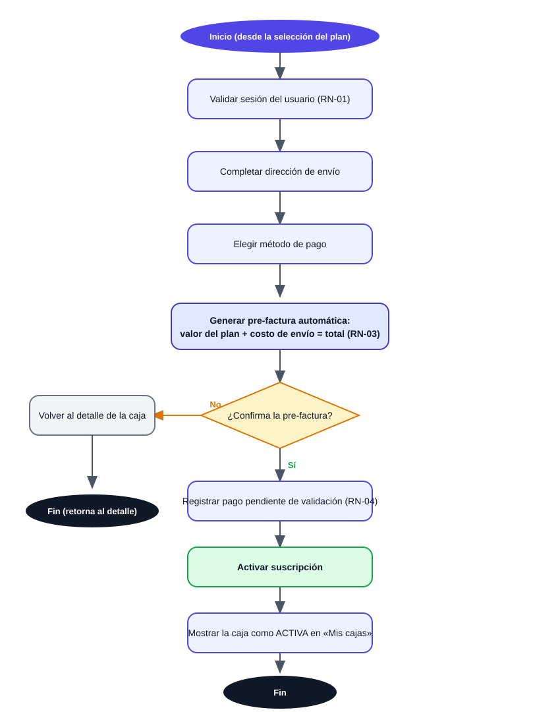

# ENTREGABLE #2 — DISEÑO DE SISTEMAS DE INFORMACIÓN

# **BOXLY: Plataforma SaaS de Suscripción a Cajas de Productos**

---

## **0. Portada**

| Campo | Detalle |
| :--- | :--- |
| **Nombre del proyecto** | **Boxly** — Plataforma SaaS de Suscripción a Cajas Temáticas |
| **Integrantes** | Andrés Felipe Orozco Paternina<br>Jose Manuel Pulgarin Rueda<br>Juan David Restrepo Alvarez<br>Jesús David Ávila Arrieta |
| **Docente** | Alexandra Guerrero Bocanegra |
| **Curso** | Diseño de Sistemas de Información |
| **Fecha** | Octubre de 2026 |
| **Institución** | Instituto Tecnológico Metropolitano (ITM) — Facultad de Ingenierías |
| **Enlace al repositorio Git** | [https://github.com/AndresFelipeOrozcoPaternina/ProyectoBoxly](https://github.com/AndresFelipeOrozcoPaternina/ProyectoBoxly) |

---

## **Propósito del Entregable**

El Entregable No. 2 evidencia la evolución técnica del proyecto y consolida de forma continua el trabajo formulado en el Entregable No. 1. Los requisitos de usuario (RU), funcionales (RF), no funcionales (RNF), reglas de negocio (RN), el story mapping y el diagrama de clases inicial no se descartan; por el contrario, se refinan, se ajustan para evitar sobreingeniería y se proyectan hacia una arquitectura multicapa clara basada en el modelo C4, la selección justificada de cinco (5) patrones de diseño GoF, el análisis riguroso de principios SOLID, la modelación de actividades del MVP y la construcción del prototipo funcional navegable.

---

## **1. Refinamiento y Consolidación del Entregable No. 1 en el Entregable No. 2**

En esta sección se evidencian los ajustes técnicos realizados sobre la base del Entregable No. 1 para garantizar la viabilidad del MVP. Las decisiones adoptadas simplifican componentes de soporte sin perder trazabilidad con los requisitos y las reglas de negocio del sistema.

### Tabla 1. Matriz de Ajustes Técnicos y Simplificación del Alcance (MVP)

| Elemento Ajustado | Estado Anterior (Entregable 1) | Estado Refinado (Entregable 2) | Justificación Técnica y Operativa |
| :--- | :--- | :--- | :--- |
| **Stack Tecnológico Backend** | Propuesta heterogénea o genérica (Node.js / Java). | **ASP.NET Core Web API (.NET / C#)**. | Estandarización de la arquitectura, tipado estricto, Inyección de Dependencias nativa y alto rendimiento en el procesamiento de transacciones. |
| **Flujo de Pago y Cobro** | Integración directa con pasarelas externas (MercadoPago / Wompi) vía patrón Adapter. | **Generación de Pre-factura con Liquidación Automática y Validación de Pago**. | Se elimina la dependencia de SDKs de terceros para el MVP, concentrando la lógica en la liquidación de planes más envío (**RN-03**) y la confirmación para activar (**RN-04**). |
| **Módulo de Analítica y Reportes** | Dashboard analítico complejo con gráficos dinámicos multidimensionales (RF-19). | **Panel de Métricas Clave Consolidadas (indicadores numéricos y resúmenes)**. | Reducción de sobreingeniería visual en el MVP, enfocando el esfuerzo en las métricas esenciales del negocio (suscripciones activas, ingresos, cajas despachadas). |
| **Selección de Patrones GoF** | Propuesta preliminar con Repository y Singleton asociados a pasarelas externas. | **Factory Method, Builder, Strategy, Observer y Facade**. | Al simplificar el cobro a pre-facturación se eliminan patrones innecesarios y se adoptan patrones coherentes con el dominio: Builder para el armado de cajas (**RN-05**), Strategy para afinidad (**RN-06**), Facade para facturación (**RN-03**) y Factory Method para planes (**RN-11**). |
| **Prototipo (Figma ➔ Funcional)** | Prototipo visual estático navegable en Figma. | **Prototipo funcional ejecutable en HTML5 / CSS3 / JavaScript**, fiel al Happy Path de Figma. | Cumplimiento del requisito de software operable: la experiencia de usuario diseñada en Figma se convierte en interfaces reales con navegación, interactividad y persistencia local. |

### 1.1 Historias de Usuario Priorizadas del MVP Implementadas

A partir del Story Mapping del Entregable No. 1, se priorizaron e implementaron las siguientes Historias de Usuario para el prototipo funcional:

| Historia de Usuario | Nombre | Función Implementada en el Prototipo | Archivo de Evidencia |
| :---: | :--- | :--- | :--- |
| **HU-1.1** | Visualización del catálogo general | Renderizado de cajas temáticas con imagen, nombre, temática, rating y precio mensual. | `front/inicio.html` |
| **HU-1.2** | Búsqueda y filtrado por categoría | Filtrado reactivo en cliente por categorías: Tecnología, Fitness, Gaming y Cuidado Personal. | `front/inicio.html` |
| **HU-1.3** | Consulta de detalle y selección de plan | Vista detallada con inclusiones de la caja y selector de periodicidad (Mensual, Semestral -10%, Anual -20%). | `front/detalle.html` |
| **HU-2.1** | Registro de nuevos usuarios | Formulario de captura de datos personales y validación básica de cuenta (RN-01). | `front/registro.html` |
| **HU-2.2** | Inicio de sesión seguro | Autenticación de credenciales para acceder a funciones de cliente. | `front/login.html` |
| **HU-3.1** | Contratación y pre-facturación | Captura de dirección, método de pago y liquidación en tiempo real: Plan + Envío ($15.000 COP) = Total. | `front/facturacion.html` |
| **HU-3.4** | Gestión y cancelación de suscripciones | Panel "Mis cajas" con estados (*Activa*, *Próxima*, *Cancelada*), modal de detalle y botón de cancelación. | `front/cajas.html` |
| — | Programa de Bonos y Recompensas | Módulo complementario de fidelización con tarjeta de puntos y canje de bonos. | `front/bonos.html` |

---

## **2. Arquitectura C4**

La arquitectura de **BOXLY** se estructuró siguiendo los cuatro niveles del modelo C4 de Simon Brown, permitiendo una visión integral desde el contexto hasta las clases de código.

```
Nivel 1: Contexto ──► Nivel 2: Contenedores ──► Nivel 3: Componentes ──► Nivel 4: Código/Clases
```

---

### **Nivel 1: Diagrama de Contexto del Sistema**

Define los límites de la plataforma BOXLY, los actores que interactúan con ella y los sistemas externos de apoyo.

* **Cliente / Suscriptor:** Explora cajas, personaliza sus preferencias de consumo, contrata planes de suscripción, consulta pre-facturas y hace seguimiento logístico (RU-01, RU-02, RU-03).
* **Administrador del Sistema:** Administra el catálogo de cajas y productos, supervisa el stock de inventario, valida pagos y gestiona novedades logísticas (RU-04, RU-05).
* **Servicio Externo de Notificaciones (SMTP):** Emite correos automáticos al confirmarse la suscripción, emitirse una pre-factura o generarse cambios en el envío.



* **Enlace editable en Google Drive (Nivel 1):** [Ver en Google Drive](https://drive.google.com/file/d/11qa34QNlKgvQn5VAcFhZry3BYY_5CXcm/view?usp=sharing)

---

### **Nivel 2: Diagrama de Contenedores**

Describe los entornos de ejecución y las tecnologías que conforman la solución tecnológica:

1. **Web Frontend (SPA - HTML5 / CSS3 / JavaScript):** Interfaz ligera y responsiva para clientes y administradores. Consume servicios REST mediante `fetch` asíncrono y gestiona estado local resiliente.
2. **API Backend (ASP.NET Core Web API / C#):** Núcleo del sistema; implementa la lógica de negocio, validaciones de dominio, orquestación de patrones GoF y exposición de endpoints RESTful.
3. **Base de Datos Relacional (PostgreSQL):** Almacenamiento transaccional de usuarios, productos, inventario, suscripciones, pre-facturas y auditoría (RNF-06).
4. **Almacenamiento Cloud de Objetos (AWS S3):** Depósito externo para imágenes de productos y recursos multimedia del catálogo.



* **Enlace editable en Google Drive (Nivel 2):** [Ver en Google Drive](https://drive.google.com/file/d/1F8uihSVGiQD0Watg1Y7xXa7IRgxZIKy9/view?usp=sharing)

---

### **Nivel 3: Diagrama de Componentes**

Representa la descomposición modular interna de la **API Backend en ASP.NET Core**:

* **`AuthController` / `UserService`:** Gestión de registro (RF-01), inicio de sesión (RF-02) y captura de preferencias de afinidad (RF-04).
* **`CatalogController` / `CatalogService`:** Consulta dinámica del catálogo (RF-05), filtros por categoría (RF-06) y detalle de cajas (RF-07).
* **`SubscriptionController` / `BillingService`:** Selección de planes (RF-09), cálculo automático de pre-facturas (**RN-03**) y validación de cobro (**RN-04**). Utiliza los patrones **Facade** y **Factory Method**.
* **`LogisticsController` / `InventoryService`:** Control de stock (RF-16, RN-06), asignación inteligente de productos por afinidad (**RN-05**) y eventos de cambio de estado logístico (RF-13, RN-08) mediante **Strategy** y **Observer**.
* **`MetricsController`:** Consolidación de indicadores clave del negocio para el panel administrativo (RF-19).



* **Enlace editable en Google Drive (Nivel 3):** [Ver en Google Drive](https://drive.google.com/file/d/1Wj_FnWiLs7r8d934HXdMNLHSaJl7Y4nX/view?usp=sharing)

---

### **Nivel 4: Código y Clases (Dominio y Patrones)**

Estructura orientada a objetos que refina el diagrama de clases del Entregable 1, incorporando abstracciones para los patrones GoF y principios SOLID:

* **Jerarquía de Usuarios:** Clase base abstracta `Persona` especializada en `Usuario` y `Administrador`.
* **Entidades del Negocio:** `Suscripcion`, `Plan`, `Prefactura`, `Caja`, `Producto`, `Inventario` y `Envio`.
* **Abstracciones de Patrones:** Interfaces `IPlanFactory`, `ICajaBuilder`, `IAsignacionStrategy`, `ISuscripcionObserver` y la clase `FacturacionFacade`.



* **Enlace editable en Google Drive (Nivel 4):** [Ver en Google Drive](https://drive.google.com/file/d/1AreANCCpeeQavlo5JtFWH9gMfhxTZlkP/view?usp=sharing)

---

## **3. Patrones de Diseño GoF**

Se seleccionaron y justificaron cinco (5) patrones de diseño de la taxonomía clásica de Gang of Four (GoF), distribuidos entre las categorías Creacionales, Estructurales y de Comportamiento. Cada patrón responde a una necesidad concreta del MVP sin redundancias:

| # | Patrón GoF | Categoría | Problema que Resuelve en Boxly | Regla / Requisito Asociado |
|---|---|---|---|---|
| **1** | **Factory Method** | Creacional | Instanciación desacoplada y polimórfica de planes (*Mensual*, *Semestral*, *Anual*) encapsulando la lógica de descuentos progresivos sin condicionales rígidos. | **RF-08, RF-17, RN-11** (Descuentos de 0%, 10% y 20%) |
| **2** | **Builder** | Creacional | Construcción paso a paso de objetos complejos `Caja`, validando en cada etapa la inclusión mínima de 2 productos, stock disponible y precios mayores a cero. | **RF-04, RF-18, RN-05** (Armado y validación de cajas) |
| **3** | **Strategy** | Comportamiento | Intercambio dinámico en tiempo de ejecución de algoritmos de armado: asignación por afinidad de preferencias vs. asignación por rotación de stock. | **RF-04, RN-05, RN-06** (Personalización de contenidos) |
| **4** | **Observer** | Comportamiento | Notificación desacoplada tipo Pub/Sub ante cambios de estado de la suscripción o envío, activando el envío de correos simulados y registro de auditoría. | **RF-13, RN-08** (Trazabilidad y notificaciones de ciclo de vida) |
| **5** | **Facade** | Estructural | Punto de entrada unificado que simplifica el subsistema de pre-facturación: orquesta el valor del plan, agrega el flete fijo ($15.000 COP) y valida la pasarela. | **RF-10, RF-11, RN-03, RN-04** (Pre-facturación y cobro) |

> **Documento Anexo Obligatorio:** El análisis pormenorizado, alternativas descartadas y roles UML se encuentran en [Anexo_Plantilla_GoF.md](Anexo_Plantilla_GoF.md).

---

## **4. Prototipo Funcional**

El prototipo funcional materializa el Happy Path prioritario diseñado en Figma durante el Entregable 1. Está construido con **HTML5 semántico, CSS3 corporativo (Dark Mode) y JavaScript vanilla modular**, permitiendo su ejecución directa en cualquier navegador sin herramientas de compilación pesadas.

### 4.1 Recorrido del Flujo Principal (Happy Path)

1. **Catálogo de Cajas (`front/inicio.html`):** Exploración visual de cajas disponibles con filtros interactivos por categoría (HU-1.1, HU-1.2).
2. **Detalle de Caja (`front/detalle.html`):** Visualización de beneficios, inclusiones y selector interactivo de plan (Mensual, Semestral con -10%, Anual con -20%) con recálculo dinámico de valores (HU-1.3, RN-11).
3. **Pre-facturación y Checkout (`front/facturacion.html`):** Ingreso de datos de entrega y cálculo en tiempo real: `Valor Plan + Costo Envío ($15.000 COP) = Total a Pagar` (**RN-03**). Confirmación de pre-factura (**RN-04**).
4. **Panel del Suscriptor (`front/cajas.html`):** La suscripción confirmada se despliega en "Mis cajas" con estado **Activo**, modal con detalle completo y opción de cancelación del servicio.
5. **Módulos Complementarios:** Registro (`registro.html`), Inicio de sesión (`login.html`), Programa de recompensas y bonos (`bonos.html`) y Configuración (`configuracion.html`).

### 4.2 Enlaces del Prototipo

* **Código fuente del prototipo:** Carpeta [front/](file:///home/jose/ProyectoBoxly/front/) del repositorio.
* **Prototipo Figma (Entregable 1):** [Ver prototipo en Figma Community](https://www.figma.com/community/file/1676053533736794296)

---

## **5. Diagramas de Actividades del MVP**

Representan el flujo procedimental de las Historias de Usuario implementadas en el prototipo funcional, incorporando nodos de decisión y caminos alternativos de retorno.

### 5.1 HU-1.1 y HU-1.2 — Exploración y Filtrado del Catálogo

El usuario ingresa al catálogo general, visualiza las tarjetas temáticas con precio y calificación, aplica filtros por categoría; si encuentra la opción deseada pasa a ver su detalle (HU-1.3); en caso contrario, continúa explorando o reinicia los filtros.



* **Archivo editable:** [diagramas/hu-1-1-1-2-exploracion-catalogo.drawio](../../diagramas/hu-1-1-1-2-exploracion-catalogo.drawio)

---

### 5.2 HU-1.3 — Detalle de Caja y Selección de Plan

Al seleccionar una caja se carga su ficha técnica y el desglose de productos incluidos. El usuario selecciona la periodicidad del plan, el sistema calcula el ahorro correspondiente (**RN-11**) y el usuario decide si continuar hacia la pre-facturación o volver al catálogo general.



* **Archivo editable:** [diagramas/hu-1-3-detalle-y-plan.drawio](../../diagramas/hu-1-3-detalle-y-plan.drawio)

---

### 5.3 HU-3.1 — Contratación y Pre-facturación

El usuario ingresa sus datos de entrega, selecciona el método de pago y el sistema genera la pre-factura consolidando plan más envío (**RN-03**). Si el pago es confirmado, la suscripción se activa (**RN-04**) y se almacena en el panel del usuario; si se cancela la operación, se retorna a la vista previa.



* **Archivo editable:** [diagramas/hu-3-1-prefacturacion.drawio](../../diagramas/hu-3-1-prefacturacion.drawio)

---

## **6. Aplicación de Principios SOLID**

Se documenta la aplicación de los cinco principios fundamentales de diseño orientado a objetos sobre los componentes de la arquitectura BOXLY:

* **S — Single Responsibility Principle (Responsabilidad Única):**  
  La entidad `Suscripcion` solo mantiene los datos de dominio y su estado. Las responsabilidades accesorias se extrajeron a clases especializadas: la persistencia reside en `SuscripcionRepository`, la liquidación y cobro en `FacturacionFacade`, y la notificación de eventos en `SuscripcionNotifier`.
* **O — Open/Closed Principle (Abierto/Cerrado):**  
  La arquitectura permite agregar nuevos tipos de planes (ej. *Plan Trimestral*) o nuevas estrategias de armado de cajas implementando la interfaz `IAsignacionStrategy` sin modificar el código orquestador existente.
* **L — Liskov Substitution Principle (Sustitución de Liskov):**  
  La jerarquía de `Persona` permite que `Usuario` y `Administrador` sean sustituidos en cualquier subsistema de autenticación y autorización polimórfica sin que el sistema falle ni requiera comprobaciones de tipo explícitas (`is` / `instanceof`).
* **I — Interface Segregation Principle (Segregación de Interfaces):**  
  Se descartaron interfaces masivas y se definieron contratos cohesivos y específicos (`IPlanFactory`, `ICajaBuilder`, `IAsignacionStrategy`, `ISuscripcionObserver`), evitando que los componentes dependan de métodos que no utilizan.
* **D — Dependency Inversion Principle (Inversión de Dependencias):**  
  Los controladores y servicios de alto nivel dependen estrictamente de abstracciones (`IFacturacionFacade`, `ISuscripcionService`, `ICajaRepository`). Las implementaciones concretas son inyectadas en tiempo de ejecución por el contenedor de Inyección de Dependencias nativo de ASP.NET Core.

> **Documento Anexo Obligatorio:** El análisis comparativo de cada principio (diseño previo en E1 vs. diseño refinado en E2) se encuentra en [Anexo_Plantilla_SOLID.md](Anexo_Plantilla_SOLID.md).

---

## **7. Anexos y Enlaces de Soporte**

* **Repositorio Oficial en GitHub:** [https://github.com/AndresFelipeOrozcoPaternina/ProyectoBoxly](https://github.com/AndresFelipeOrozcoPaternina/ProyectoBoxly)
* **Prototipo Navegable en Figma:** [https://www.figma.com/community/file/1676053533736794296](https://www.figma.com/community/file/1676053533736794296)
* **Enlaces Editables del Modelo C4 (Google Drive):**
  * Nivel 1 (Contexto): [Abrir en Drive](https://drive.google.com/file/d/11qa34QNlKgvQn5VAcFhZry3BYY_5CXcm/view?usp=sharing)
  * Nivel 2 (Contenedores): [Abrir en Drive](https://drive.google.com/file/d/1F8uihSVGiQD0Watg1Y7xXa7IRgxZIKy9/view?usp=sharing)
  * Nivel 3 (Componentes): [Abrir en Drive](https://drive.google.com/file/d/1Wj_FnWiLs7r8d934HXdMNLHSaJl7Y4nX/view?usp=sharing)
  * Nivel 4 (Clases): [Abrir en Drive](https://drive.google.com/file/d/1AreANCCpeeQavlo5JtFWH9gMfhxTZlkP/view?usp=sharing)
* **Plantilla de Análisis de Patrones GoF Diligenciada:** [Anexo_Plantilla_GoF.md](Anexo_Plantilla_GoF.md)
* **Plantilla de Análisis de Principios SOLID Diligenciada:** [Anexo_Plantilla_SOLID.md](Anexo_Plantilla_SOLID.md)
* **Infografía de Patrones GoF (Catálogo 23 Patrones):** [Infografía de GoF.jpeg](Infografía%20de%20GoF.jpeg)
* **Bibliografía y Referencias:**
  * Brown, S. (2018). *The C4 model for visualising software architecture*. [https://c4model.com](https://c4model.com)
  * Gamma, E., Helm, R., Johnson, R., & Vlissides, J. (1994). *Design Patterns: Elements of Reusable Object-Oriented Software*. Addison-Wesley.
  * Martin, R. C. (2017). *Clean Architecture: A Craftsman's Guide to Software Structure and Design*. Prentice Hall.
