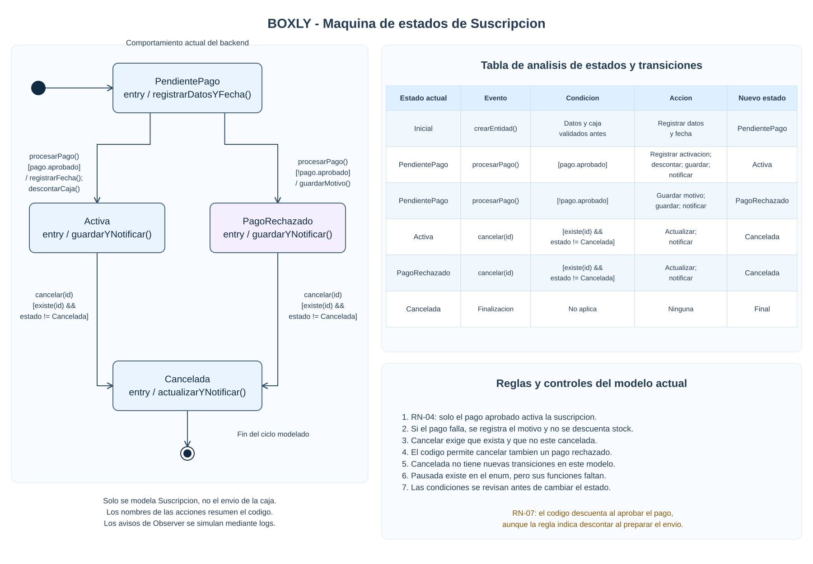

# 2. Maquina de estados de Suscripcion

## Nombre y descripcion de la entidad

**Suscripcion** representa la contratacion de una caja y un plan por un usuario. Su estado permite saber si el pago esta pendiente, si la suscripcion esta activa, si el pago fue rechazado o si fue cancelada.

El modelo corresponde al comportamiento actual del backend. Sigue la estructura de la imagen de referencia y la notacion de **D. Maquina de Estados UML.pdf**: punto inicial, estados, transiciones, condiciones de guarda, acciones de entrada y simbolo final. No representa epicas ni etapas del envio.

## Imagen y enlace editable

Direccion de la imagen: [maquina-estados-suscripcion.svg](maquina-estados-suscripcion.svg).

Enlace editable del diagrama: [abrir en Google Drive](https://drive.google.com/file/d/14PDJ0YwMDWaLrAfbfpkl844eE5aOgG03/view?usp=sharing).

Archivo local: [descargar .drawio](maquina-estados-suscripcion.drawio).

La imagen incluye el diagrama a la izquierda, la tabla de analisis a la derecha y las reglas debajo. Los estados, textos, tablas y flechas del archivo .drawio se pueden editar.

## Matriz de analisis de estados y transiciones

| Estado actual | Evento | Condicion de guarda | Accion asociada | Nuevo estado |
| --- | --- | --- | --- | --- |
| Inicial | crearEntidad() | Los datos se validan antes de crear la entidad. La caja debe existir y tener stock. | Registrar identificador, datos y fecha de creacion. | PendientePago |
| PendientePago | procesarPago() | pago.aprobado | Registrar la fecha de activacion, descontar una caja, guardar y notificar. | Activa |
| PendientePago | procesarPago() | !pago.aprobado | Registrar el motivo del rechazo, guardar y notificar. | PagoRechazado |
| Activa | cancelar(id) | existe(id) && estado != Cancelada | Actualizar el registro y notificar. | Cancelada |
| PagoRechazado | cancelar(id) | existe(id) && estado != Cancelada | Actualizar el registro y notificar. | Cancelada |
| Cancelada | Finalizacion del ciclo modelado | No aplica. | Ninguna. El registro se conserva. | Final |

El punto negro indica el inicio. **PendientePago**, **Activa** y **PagoRechazado** son estados intermedios del ciclo representado. **Cancelada** conduce al simbolo final. Ese simbolo indica que termina el comportamiento modelado; no elimina el registro ni representa un metodo adicional del servidor.

## Explicacion de las transiciones

1. **Creacion:** el servicio revisa que la caja exista y que queden existencias. Calcula la prefactura y crea la entidad en PendientePago. Si la caja no existe o no tiene stock, devuelve un error antes de crear la suscripcion.
2. **Pago aprobado:** procesarPago() obtiene el resultado de la simulacion. Si pago.aprobado es verdadero, la suscripcion pasa a Activa. Se registra la fecha, se descuenta una caja, se guarda y se notifica el cambio.
3. **Pago rechazado:** si pago.aprobado es falso, la suscripcion pasa a PagoRechazado. Se conserva el motivo, se guarda y se notifica. No se descuenta inventario. Las condiciones de aprobacion y rechazo son excluyentes.
4. **Cancelacion:** cancelar(id) exige que el registro exista y que no este cancelado. El codigo admite cancelar tanto una suscripcion Activa como una PagoRechazado. Ambas rutas terminan en Cancelada.
5. **Cierre:** Cancelada no tiene nuevas transiciones en este modelo. Si se intenta cancelar otra vez, el servicio devuelve un error y conserva el estado.

Las etiquetas se leen como **evento [condicion] / accion**. Una guarda permite el cambio solo si se cumple. Los textos `entry / guardarYNotificar()` y `entry / actualizarYNotificar()` agrupan las acciones realizadas al ingresar a esos estados. Son nombres resumidos para explicar el codigo; no son metodos nuevos. Los efectos escritos sobre las flechas ocurren antes de esas acciones de entrada.

## Reglas y controles

- Solo el pago aprobado activa la suscripcion, de acuerdo con RN-04.
- Un pago rechazado conserva el motivo y no descuenta cajas.
- Para cancelar, el registro debe existir y su estado debe ser distinto de Cancelada.
- La cancelacion tambien se permite desde PagoRechazado, porque el metodo actual no exige estar Activa.
- Las notificaciones se simulan mediante logs; no acreditan envio real de correo.
- PendientePago es un estado durante la creacion: el pago se procesa en esa misma operacion, no mediante una tarea posterior.

## Relacion con los entregables anteriores y el MVP

| Referencia | Relacion con el modelo |
| --- | --- |
| RF-09, RF-10, RN-03 y HU-3.1 de E2 | La seleccion del plan y el calculo de la prefactura proporcionan los datos para crear la suscripcion. Una cotizacion por si sola no crea la entidad. |
| RF-11 y RN-04 | El resultado del pago determina si la suscripcion pasa a Activa o a PagoRechazado. El pago actual es simulado. |
| HU-3.4 de E2 | La funcion de cancelacion se representa mediante el paso a Cancelada. |
| RN-06 y RN-07 | El codigo verifica stock antes de crear y descuenta al activar. Existe una diferencia con RN-07, que indica descontar al preparar el envio. El diagrama muestra el comportamiento actual. |
| RN-08 y RF-13 | Describen el seguimiento del envio. Preparando, Enviada y Entregada corresponden a ese proceso y no se agregan a Suscripcion. |

La clase [Suscripcion](../../backend/Boxly.Api/Models/Entities/Suscripcion.cs) contiene sus datos y el estado. [EstadoSuscripcion](../../backend/Boxly.Api/Models/Enums/EstadoSuscripcion.cs) declara los valores posibles. [SuscripcionService](../../backend/Boxly.Api/Services/SuscripcionService.cs) realiza la creacion y cancelacion. [FacturacionFacade](../../backend/Boxly.Api/Patterns/Facade/FacturacionFacade.cs) calcula la prefactura y simula el pago.

El modelo complementa el diagrama de clases: la clase describe la estructura y este diagrama explica sus cambios de estado. La contratacion se relaciona con HU-3.1 y la cancelacion con HU-3.4 del [Entregable 2](../entregable2/Arquitectura%20C4.md). Las reglas proceden del [Entregable 1](../entregable1/Entregable_1.md).

## Alcance de la revision

Se documento el codigo existente, sin modificar el backend ni agregar propuestas. `Pausada` esta declarado en el enum, pero no se representa porque no hay funciones implementadas para llegar a ese estado o salir de el. Tampoco se presentan la identidad del usuario, la unicidad mensual o el acceso a datos propios como guardas existentes: siguen siendo requisitos pendientes del sistema.

Se revisaron la estructura XML del archivo editable, las referencias de sus conectores y los enlaces locales del documento. Esta tarea no agrega pruebas ni constituye una nueva ejecucion del MVP. Los textos de este documento y del diagrama estan escritos sin tildes.
