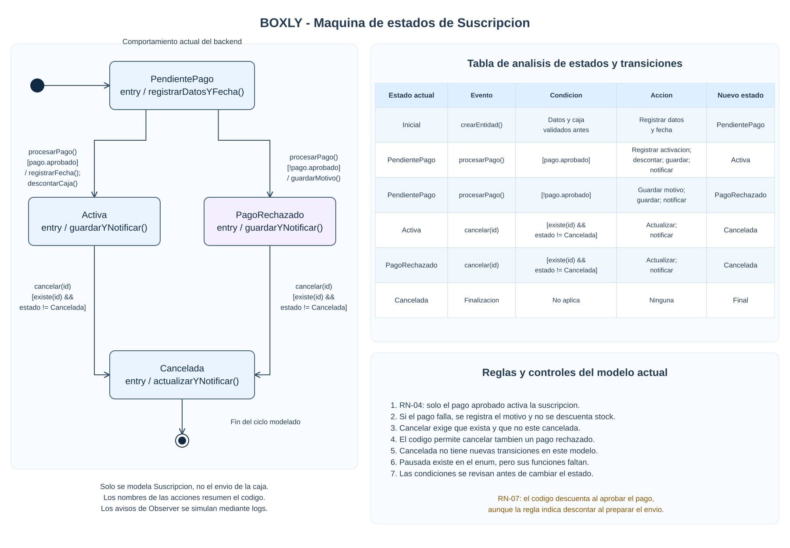
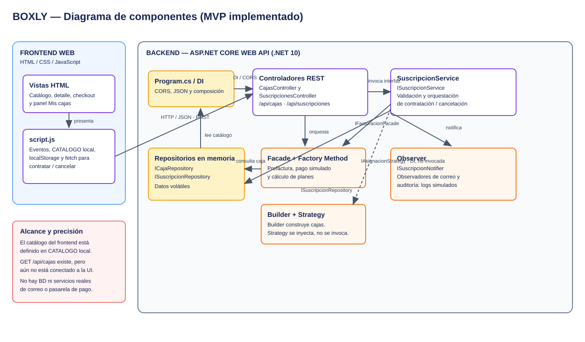
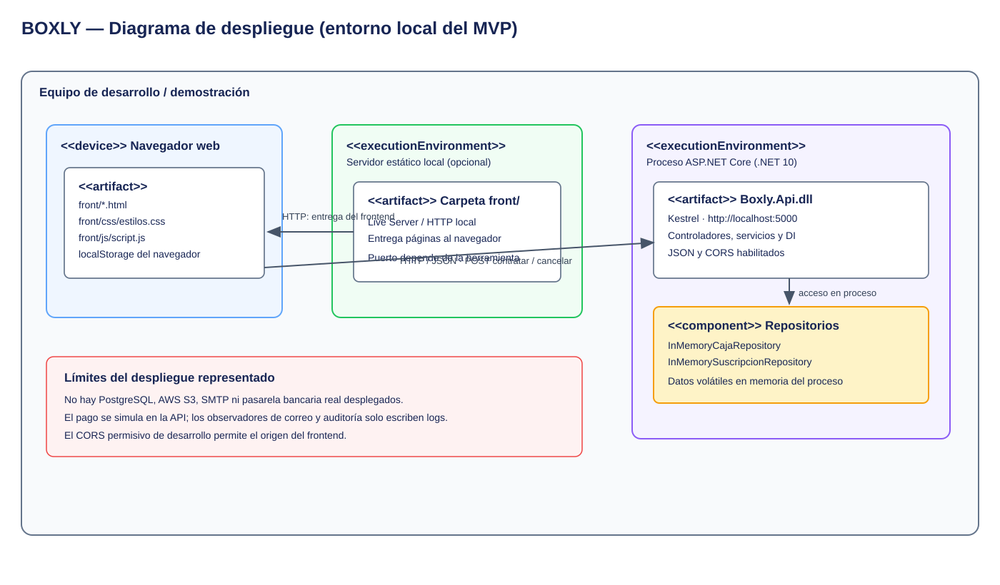

ENTREGABLE #3 DISEÑO DE SISTEMAS DE INFORMACIÓN 

# **Propósito del entregable** 

El Entregable No.3 debe evidenciar la evolución técnica del proyecto a partir de la consolidación de los Entregables No. 1 y No. 2. Esta entrega no debe entenderse como una actividad aislada, sino como una fase de refinamiento, integración y validación funcional del sistema. 

En el Entregable No.1, el equipo definió la base del sistema mediante el modelo verbal, requisitos de usuario, requisitos funcionales y no funcionales, reglas de negocio, story mapping, historias de usuario o casos de uso, diagrama de clases y prototipo en Figma. 

En el Entregable No.2, el equipo tomó esos insumos y los desarrolló técnicamente mediante el refinamiento del E1, la arquitectura C4, los patrones de diseño, el prototipo funcional, los diagramas de actividades del MVP y el análisis de principios SOLID. 

Por tanto, el Entregable No.3 debe demostrar que el sistema avanza hacia una solución más madura, incorporando el refinamiento de los artefactos previos, la modelación del comportamiento mediante estados, la representación estructural y de distribución del sistema, la modelación de interacciones internas mediante diagramas de secuencia y la construcción de un MVP funcional con flujos alternativos. 

# **0. Portada** 

- Nombre del proyecto 

- Integrantes 

- Docente 

- Curso 

- Fecha 

- Institución 

- 

- Enlace al repositorio Git 

# 1. Refinamiento y consolidación de los entregables 1 y 2

Esta sección sigue el primer punto de la guía **Entregable 3.docx**. Explica cómo el trabajo de E1 y E2 sirve de base para el sistema actual: qué se conservó, qué se llevó al código y qué debe ajustarse para que los documentos y el programa coincidan.

La comparación se hizo leyendo los entregables anteriores y el código actual. No se ejecutaron pruebas. Cuando un ajuste todavía no se ha realizado, se indica como pendiente.

## Tabla 1. Ajustes realizados frente a los entregables anteriores

| Elemento ajustado | Entregable de origen | Cómo estaba antes | Cómo quedó refinado | Motivo del ajuste |
| --- | --- | --- | --- | --- |
| Requisitos de compra y reglas de pago | E1: RF-09, RF-10, RF-11, RN-03 y RN-04. E2: prefacturación. | Se definió que el usuario elige un plan, revisa el total y confirma el pago. E2 planteó confirmación manual. | El código calcula el plan más el envío y simula un pago aprobado o rechazado. Solo activa la suscripción si el pago se aprueba. Queda pendiente ajustar la descripción de pago manual de E2. | Llevar las reglas de E1 a un proceso que el servidor pueda resolver y mostrar qué sucede si el pago falla. |
| Story mapping e historias de usuario del MVP | E1: actividades e historias del usuario. E2: historias priorizadas del MVP. | Se organizaron las funciones de explorar cajas, elegir un plan y contratar. E2 las presentó mediante páginas del prototipo. | Se conserva ese recorrido. La página de contratación envía la compra al servidor y muestra su respuesta. El catálogo sigue definido en el navegador. | Continuar el recorrido elegido en las entregas anteriores y precisar qué parte ya está conectada al servidor. |
| Prototipo funcional | E1: prototipo Figma. E2: prototipo HTML, CSS y JavaScript. | El diseño de pantallas se convirtió en un prototipo para recorrer la compra normal. | La contratación incorpora respuestas de compra aprobada y pago rechazado. Hay código para tratar otros errores de la solicitud. Su ejecución desde el navegador queda pendiente de verificar. | Ampliar el prototipo para explicar tanto una compra exitosa como las situaciones alternativas que pide E3. |
| Arquitectura C4 y organización del sistema | E2: niveles de contenedores y componentes. | Se propuso separar la interfaz, los servicios del servidor y una base de datos PostgreSQL. | El proyecto tiene carpetas de frontend y backend. El servidor separa controladores, servicios y acceso a datos, pero guarda las suscripciones en memoria. PostgreSQL queda como propuesta; falta actualizar los diagramas. | Mantener la separación diseñada en E2 y aclarar qué partes existen y cuáles faltan por construir. |
| Diagrama de clases y estados de la suscripción | E1: diagrama de clases. E2: nivel 4 de C4 y HU-3.4. | Se describieron las clases del sistema y funciones como contratar, pausar y cancelar. | El código define una clase de suscripción y estados de pago pendiente, activa, pago rechazado, pausada y cancelada. Implementa aprobación, rechazo y cancelación; la pausa está pendiente. Esta información servirá para el punto 2. | Usar las clases anteriores como base de la máquina de estados y dibujar cambios que correspondan al comportamiento del programa. |
| Patrones de diseño | E2: selección de cinco patrones GoF y anexo de análisis. | Se eligieron Factory Method, Builder, Strategy, Observer y Facade para organizar las responsabilidades del sistema. | Existen clases para los cinco patrones. La creación de planes, el cálculo del cobro y los avisos de cambios tienen código. La compra todavía no llama a la asignación de productos por preferencias; los avisos de correo son mensajes de registro. | Conservar las decisiones de E2 y precisar hasta dónde se aplicaron, sin presentar funciones incompletas como terminadas. |
| Principios SOLID | E2: análisis y anexo SOLID. | Se propuso separar responsabilidades y usar interfaces para reducir la dependencia entre clases. | El controlador recibe solicitudes, el servicio coordina la compra, la fachada calcula el cobro y el repositorio guarda datos. El servicio recibe estas dependencias mediante interfaces. Falta ajustar en los documentos los nombres que no coinciden con el código. | Mostrar con clases concretas cómo las ideas de E2 se reflejan en la organización del programa. |
| Diagramas de actividades previos | E2: catálogo, detalle y contratación. | Se dibujó el recorrido principal de las historias del MVP. | Se conserva ese recorrido como referencia. El código de contratación añade caminos de caja inexistente, falta de existencias y pago rechazado. Actualizar los diagramas y crear los de E3 sigue pendiente. | Usar los diagramas anteriores como punto de partida para explicar las decisiones y errores del proceso actual. |
| Reglas que requieren más trabajo | E1: RN-01, RN-02, RN-07, RN-08 y RN-09. E2: almacenamiento e inventario. | Se pidió acceso por usuario, una suscripción activa por periodo, descuento de inventario al preparar el envío y seguimiento de la entrega. | La revisión conserva estas reglas como pendientes: el servidor no comprueba la identidad del usuario ni las suscripciones repetidas; descuenta la caja al aprobar el pago y no implementa el recorrido de envío. También falta guardar los datos de forma permanente. | Mantener visibles los compromisos de E1 y E2 y evitar que una función pendiente se confunda con un ajuste ya terminado. |

## Qué comparamos y por qué

Comparamos los **productos de E1 y E2** con su uso en el **MVP actual**, como pide el primer punto del Word. La tabla explica la continuidad del proyecto: requisitos → diseño → código.

Por ejemplo, E1 definió que una suscripción solo se activa con el pago confirmado. E2 propuso cómo resolver el cobro. El código actual simula el pago y decide si activa o rechaza la suscripción. Esta comparación tiene sentido porque muestra cómo una regla de la primera entrega llega a convertirse en una acción del programa.

Los ajustes de documentación realizados aquí aclaran esa relación. Los cambios de código y de diagramas señalados como pendientes todavía deben hacerse; esta tabla no los da por terminados.

## Tabla 2. Evidencias para verificar la comparación

Las rutas parten de esta carpeta. Estos enlaces permiten comprobar las afirmaciones de la tabla anterior.

| Referencia | Qué se comparó | Evidencia anterior | Evidencia actual y qué revisar |
| --- | --- | --- | --- |
| Recorrido de compra | Requisitos y HU frente a la integración web | [E1: requisitos](../entregable1/Entregable_1.md); [E2: sección 1.1](../entregable2/Arquitectura%20C4.md) | [script.js](../../front/js/script.js): `CATALOGO`, petición `POST` a suscripciones y respuestas del servidor. |
| Pago e inventario | Reglas de cobro, inventario y unicidad frente a la contratación | [E1: reglas de negocio](../entregable1/Entregable_1.md); [E2: decisiones de pago](../entregable2/Arquitectura%20C4.md) | [SuscripcionService.cs](../../backend/Boxly.Api/Services/SuscripcionService.cs): `CrearSuscripcionAsync`; [FacturacionFacade.cs](../../backend/Boxly.Api/Patterns/Facade/FacturacionFacade.cs): liquidación y pago simulado. |
| Estados | Estados de interfaz, suscripción y envío | [E1: RN-08](../entregable1/Entregable_1.md); [E2: HU-3.4](../entregable2/Arquitectura%20C4.md) | [EstadoSuscripcion.cs](../../backend/Boxly.Api/Models/Enums/EstadoSuscripcion.cs); [SuscripcionService.cs](../../backend/Boxly.Api/Services/SuscripcionService.cs): creación y cancelación. |
| Arquitectura | Contenedores y componentes proyectados frente a clases registradas | [E2: C4 niveles 2 a 4](../entregable2/Arquitectura%20C4.md) | [Program.cs](../../backend/Boxly.Api/Program.cs): DI; [SuscripcionRepository.cs](../../backend/Boxly.Api/Repositories/SuscripcionRepository.cs): diccionario en memoria. |
| Patrones y SOLID | Justificación de patrones y SOLID frente a su uso | [Anexo GoF](../entregable2/Anexo_Plantilla_GoF.md); [Anexo SOLID](../entregable2/Anexo_Plantilla_SOLID.md) | [Strategy](../../backend/Boxly.Api/Patterns/Strategy/AsignacionStrategy.cs); [Observer](../../backend/Boxly.Api/Patterns/Observer/SuscripcionObserver.cs); [SuscripcionService.cs](../../backend/Boxly.Api/Services/SuscripcionService.cs); [Program.cs](../../backend/Boxly.Api/Program.cs). |
| Acceso por usuario | Restricciones de acceso frente a endpoints y configuración | [E1: RN-01, RN-09 y requisitos de seguridad](../entregable1/Entregable_1.md) | [SuscripcionesController.cs](../../backend/Boxly.Api/Controllers/SuscripcionesController.cs): listado sin filtro de identidad; [Program.cs](../../backend/Boxly.Api/Program.cs): configuración de servicios y middleware. |
| Pruebas existentes | Demostración del camino principal frente a casos alternativos | [Guía E2: sección 4](../entregable2/Entregable_2.md) | [TestSuiteRunner.cs](../../backend/Boxly.Api/Services/TestSuiteRunner.cs): casos y aserciones existentes. Esta revisión no ejecutó la suite. |


# 2. Maquina de estados de Suscripcion

## Nombre y descripcion de la entidad

**Suscripcion** representa la contratacion de una caja y un plan por un usuario. Su estado permite saber si el pago esta pendiente, si la suscripcion esta activa, si el pago fue rechazado o si fue cancelada.

El modelo corresponde al comportamiento actual del backend. Sigue la estructura de la imagen de referencia y la notacion de **D. Maquina de Estados UML.pdf**: punto inicial, estados, transiciones, condiciones de guarda, acciones de entrada y simbolo final. No representa epicas ni etapas del envio.

## Imagen y enlace editable



Direccion de la imagen: [maquina-estados-suscripcion.svg](maquina-estados-suscripcion.svg).

Enlace editable del diagrama: [abrir en Google Drive](https://drive.google.com/file/d/14PDJ0YwMDWaLrAfbfpkl844eE5aOgG03/view?usp=sharing).

Archivo local: [descargar .drawio](maquina-estados-suscripcion.drawio).

La imagen incluye el diagrama a la izquierda, la tabla de analisis a la derecha y las reglas debajo. Los estados, textos, tablas y flechas del archivo .drawio se pueden editar.

## Matriz de analisis de estados y transiciones

| Estado actual | Evento | Condicion de guarda | Accion asociada | Nuevo estado |
| --- | --- | --- | --- | --- |
| Inicial | crearEntidad() | Los datos se validan antes de crear la entidad. La caja debe existir y tener stock. | Registrar identificador, datos y fecha de creacion. | PendientePago |
| PendientePago | procesarPago() | pago.aprobado | Registrar la fecha de activacion, descontar una caja, guardar y notificar. | Activa |
| PendientePago | procesarPago() | !pago.aprobado | Registrar el motivo del rechazo, guardar y notificar. | PagoRechazado |
| Activa | cancelar(id) | existe(id) && estado != Cancelada | Actualizar el registro y notificar. | Cancelada |
| PagoRechazado | cancelar(id) | existe(id) && estado != Cancelada | Actualizar el registro y notificar. | Cancelada |
| Cancelada | Finalizacion del ciclo modelado | No aplica. | Ninguna. El registro se conserva. | Final |

El punto negro indica el inicio. **PendientePago**, **Activa** y **PagoRechazado** son estados intermedios del ciclo representado. **Cancelada** conduce al simbolo final. Ese simbolo indica que termina el comportamiento modelado; no elimina el registro ni representa un metodo adicional del servidor.

## Explicacion de las transiciones

1. **Creacion:** el servicio revisa que la caja exista y que queden existencias. Calcula la prefactura y crea la entidad en PendientePago. Si la caja no existe o no tiene stock, devuelve un error antes de crear la suscripcion.
2. **Pago aprobado:** procesarPago() obtiene el resultado de la simulacion. Si pago.aprobado es verdadero, la suscripcion pasa a Activa. Se registra la fecha, se descuenta una caja, se guarda y se notifica el cambio.
3. **Pago rechazado:** si pago.aprobado es falso, la suscripcion pasa a PagoRechazado. Se conserva el motivo, se guarda y se notifica. No se descuenta inventario. Las condiciones de aprobacion y rechazo son excluyentes.
4. **Cancelacion:** cancelar(id) exige que el registro exista y que no este cancelado. El codigo admite cancelar tanto una suscripcion Activa como una PagoRechazado. Ambas rutas terminan en Cancelada.
5. **Cierre:** Cancelada no tiene nuevas transiciones en este modelo. Si se intenta cancelar otra vez, el servicio devuelve un error y conserva el estado.

Las etiquetas se leen como **evento [condicion] / accion**. Una guarda permite el cambio solo si se cumple. Los textos `entry / guardarYNotificar()` y `entry / actualizarYNotificar()` agrupan las acciones realizadas al ingresar a esos estados. Son nombres resumidos para explicar el codigo; no son metodos nuevos. Los efectos escritos sobre las flechas ocurren antes de esas acciones de entrada.

## Reglas y controles

- Solo el pago aprobado activa la suscripcion, de acuerdo con RN-04.
- Un pago rechazado conserva el motivo y no descuenta cajas.
- Para cancelar, el registro debe existir y su estado debe ser distinto de Cancelada.
- La cancelacion tambien se permite desde PagoRechazado, porque el metodo actual no exige estar Activa.
- Las notificaciones se simulan mediante logs; no acreditan envio real de correo.
- PendientePago es un estado durante la creacion: el pago se procesa en esa misma operacion, no mediante una tarea posterior.

## Relacion con los entregables anteriores y el MVP

| Referencia | Relacion con el modelo |
| --- | --- |
| RF-09, RF-10, RN-03 y HU-3.1 de E2 | La seleccion del plan y el calculo de la prefactura proporcionan los datos para crear la suscripcion. Una cotizacion por si sola no crea la entidad. |
| RF-11 y RN-04 | El resultado del pago determina si la suscripcion pasa a Activa o a PagoRechazado. El pago actual es simulado. |
| HU-3.4 de E2 | La funcion de cancelacion se representa mediante el paso a Cancelada. |
| RN-06 y RN-07 | El codigo verifica stock antes de crear y descuenta al activar. Existe una diferencia con RN-07, que indica descontar al preparar el envio. El diagrama muestra el comportamiento actual. |
| RN-08 y RF-13 | Describen el seguimiento del envio. Preparando, Enviada y Entregada corresponden a ese proceso y no se agregan a Suscripcion. |

La clase [Suscripcion](../../backend/Boxly.Api/Models/Entities/Suscripcion.cs) contiene sus datos y el estado. [EstadoSuscripcion](../../backend/Boxly.Api/Models/Enums/EstadoSuscripcion.cs) declara los valores posibles. [SuscripcionService](../../backend/Boxly.Api/Services/SuscripcionService.cs) realiza la creacion y cancelacion. [FacturacionFacade](../../backend/Boxly.Api/Patterns/Facade/FacturacionFacade.cs) calcula la prefactura y simula el pago.

El modelo complementa el diagrama de clases: la clase describe la estructura y este diagrama explica sus cambios de estado. La contratacion se relaciona con HU-3.1 y la cancelacion con HU-3.4 del [Entregable 2](../entregable2/Arquitectura%20C4.md). Las reglas proceden del [Entregable 1](../entregable1/Entregable_1.md).

## Alcance de la revision

Se documento el codigo existente, sin modificar el backend ni agregar propuestas. `Pausada` esta declarado en el enum, pero no se representa porque no hay funciones implementadas para llegar a ese estado o salir de el. Tampoco se presentan la identidad del usuario, la unicidad mensual o el acceso a datos propios como guardas existentes: siguen siendo requisitos pendientes del sistema.

Se revisaron la estructura XML del archivo editable, las referencias de sus conectores y los enlaces locales del documento. Esta tarea no agrega pruebas ni constituye una nueva ejecucion del MVP. Los textos de este documento y del diagrama estan escritos sin tildes.


# **3. Diagrama integrado de componentes y despliegue**

Los diagramas muestran dos vistas complementarias de la arquitectura que está implementada en el MVP. Se distinguen las capacidades presentes en el código de las propuestas de infraestructura del Entregable 2 que todavía no se han construido.

## Diagrama de componentes



Archivo editable: [arquitectura-componentes.drawio](../../diagramas/arquitectura-componentes.drawio). Imagen: [arquitectura-componentes.svg](../../diagramas/arquitectura-componentes.svg).

La interfaz web se compone de páginas HTML, estilos compartidos y `script.js`. El script presenta el catálogo que mantiene en la constante `CATALOGO`, conserva localmente las suscripciones confirmadas y envía al backend las operaciones de contratación y cancelación. El backend expone controladores REST; `SuscripcionesController` delega las reglas del ciclo de vida en `SuscripcionService`, mientras que `CajasController` permite consultar las cajas y cotizar. El servicio coordina los repositorios, la fachada de facturación y las notificaciones de cambios de estado.

Las interfaces (`ISuscripcionService`, `ICajaRepository`, `ISuscripcionRepository`, `IFacturacionFacade`, `IPlanFactory` e `ISuscripcionNotifier`) explicitan las dependencias entre módulos y se conectan mediante inyección de dependencias en `Program.cs`. `CajaBuilder` construye las cajas del catálogo y `PlanFactory` calcula las variantes de plan usadas por la fachada. `IAsignacionStrategy` está registrada e inyectada, pero el flujo actual de contratación no la invoca; el diagrama la marca como dependencia configurada, no como comportamiento ejecutado. Los observadores de correo y auditoría registran mensajes en logs, no envían notificaciones externas.

Una diferencia relevante frente a la arquitectura propuesta en E2 es que el navegador todavía no consulta el endpoint `GET /api/cajas`: el listado, filtros y detalle mostrados por el frontend provienen del catálogo JavaScript local. Los endpoints de catálogo están implementados en el API, pero su integración con esas vistas queda pendiente. El checkout sí envía la contratación al API y `Mis cajas` intenta enviar la cancelación.

## Diagrama de despliegue



Archivo editable: [arquitectura-despliegue.drawio](../../diagramas/arquitectura-despliegue.drawio). Imagen: [arquitectura-despliegue.svg](../../diagramas/arquitectura-despliegue.svg).

Para la demostración, el navegador carga `front/` desde un servidor HTTP estático local (por ejemplo, Live Server) y se comunica por HTTP/JSON con el proceso ASP.NET Core. El frontend configura `API_BASE_URL` como `http://localhost:5000/api`; por eso, al seguir el comando del README, la API se inicia con `--urls "http://localhost:5000"`. El CORS del backend permite la comunicación entre esos orígenes locales. El puerto del servidor estático depende de la herramienta y no forma parte del contrato del API.

Los repositorios actuales mantienen cajas y suscripciones en memoria dentro del proceso de la API. No existe una base de datos configurada y los registros se pierden al reiniciar el proceso. Tampoco se despliegan AWS S3, SMTP ni una pasarela bancaria: el procesamiento de pago se simula en `FacturacionFacade` y los avisos se limitan a logs. PostgreSQL y servicios externos que aparecen en la arquitectura objetivo de E2 son elementos proyectados, no nodos del MVP desplegado.

## Correspondencia entre vistas y alcance

El servidor ASP.NET Core que aloja los controladores y servicios del diagrama de componentes corresponde al nodo de ejecución `Boxly.Api.dll` del despliegue. Los repositorios que esos componentes requieren están dentro del mismo proceso; no se dibuja un nodo de base de datos separado porque aún no hay persistencia externa. El navegador ejecuta las vistas y `script.js`, y obtiene los archivos del servidor estático local.

Esta separación permite que el backend aplique las validaciones de compra, calcule el cobro, registre los estados y responda con códigos HTTP sin depender de la presentación. El frontend puede seguir mostrando el prototipo si el API no está disponible, pero eso no convierte el almacenamiento local en persistencia del servidor. Las limitaciones descritas mantienen la arquitectura consistente con el código fuente actual y con los flujos que se pueden demostrar.

# **4. Diagrama de secuencia** 

En esta sección, el equipo debe presentar diagramas de secuencia UML que representen las interacciones necesarias para ejecutar las funcionalidades principales del MVP. 

Se debe elaborar al menos un diagrama por cada épica implementada, seleccionando un escenario representativo asociado a una historia de usuario o caso de uso. 

Cada diagrama debe evidenciar la comunicación entre los actores y los elementos de software involucrados, respetando las responsabilidades definidas en el diseño. 

Cada diagrama debe incluir: 

- Nombre del escenario, épica e historia de usuario o caso de uso asociado 

- Actor principal y participantes involucrados 

ENTREGABLE #3 DISEÑO DE SISTEMAS DE INFORMACIÓN 

- Líneas de vida de los objetos, componentes o servicios 

- Mensajes, llamadas y respuestas 

- Orden temporal de las interacciones 

- Fragmentos combinados alt, opt o loop, cuando corresponda 

- Flujo principal y al menos un flujo alternativo o de excepción relevante 

   - Imagen legible y enlace editable 

- Explicación técnica del comportamiento representado 

Los diagramas deben mantener coherencia con el diagrama de clases, los diagramas de componentes, las reglas de negocio y las funcionalidades implementadas. 

**Importante** : No se aceptarán diagramas que únicamente representen la navegación entre pantallas. Se deben evidenciar las interacciones internas del sistema y las decisiones técnicas necesarias para ejecutar el escenario. 

# **5. MVP funcional con flujos alternativos (Backend)**

En este entregable se presenta la evolución del MVP desde el prototipo estático del Entregable No. 2 hacia una **solución cliente-servidor para el flujo de contratación**, incorporando una **API RESTful desarrollada en ASP.NET Core (.NET 10 / C#)** que ejecuta validaciones de dominio y reglas de negocio y maneja flujos principales y alternativos. Los repositorios actuales mantienen los datos en memoria; no hay persistencia externa.

### 5.1 Tecnologías Utilizadas y Arquitectura del Backend

* **Framework y Lenguaje:** ASP.NET Core Web API (.NET 10) sobre C# 13.
* **Inyección de Dependencias:** Contenedor nativo de ASP.NET Core (`Microsoft.Extensions.DependencyInjection`).
* **Comunicación y Serialización:** Controladores RESTful con serialización JSON estándar (conversión de enumeraciones tipadas y políticas CORS permisivas para el frontend).
* **Integración Frontend:** Cliente web en HTML5/CSS3/JavaScript con llamadas asíncronas (`fetch`) y fallback resiliente en almacenamiento local.

### 5.2 Aplicación Justificada de Patrones GoF en el Backend

El backend materializa en código fuente los cinco (5) patrones de diseño analizados en la plantilla del Entregable No. 2:

| # | Patrón GoF | Tipo | Clase / Interfaz en Código | Problema que resuelve y Regla de Negocio asociada |
|---|---|---|---|---|
| 1 | **Factory Method** | Creacional | `IPlanFactory`, `PlanCreator`, `PlanFactory.cs` | Permite instanciar y calcular dinámicamente las variantes de planes de suscripción (*Mensual*, *Semestral* y *Anual*) encapsulando la lógica de descuentos progresivos (**RN-11: 0 %, 10 % y 20 %**) sin estructuras condicionales rígidas. |
| 2 | **Builder** | Creacional | `ICajaBuilder`, `CajaBuilder.cs` | Construye paso a paso objetos complejos de tipo `Caja`, aplicando validaciones de dominio antes de crear la instancia (mínimo 2 ítems incluidos, precios mayores a cero y control de stock según **RN-05**). |
| 3 | **Strategy** | Comportamiento | `IAsignacionStrategy`, `AsignacionStrategy.cs` | Permite intercambiar en tiempo de ejecución los algoritmos de asignación de productos (*AsignacionEstandarStrategy* vs. *AsignacionPorAfinidadStrategy*), personalizando el kit según las preferencias del usuario (**RF-04, RN-05, RN-06**). |
| 4 | **Observer** | Comportamiento | `ISuscripcionObserver`, `SuscripcionObserver.cs` | Notifica de forma desacoplada los cambios de estado en el ciclo de vida de la suscripción (ej. `PendientePago` ➔ `Activa` o `PagoRechazado` o `Cancelada`) disparando acciones de correo simulado (`EmailNotificationObserver`) y bitácora de auditoría (`AuditoriaSuscripcionObserver`) (**RF-13, RN-08**). |
| 5 | **Facade** | Estructural | `IFacturacionFacade`, `FacturacionFacade.cs` | Proporciona una interfaz unificada que simplifica el subsistema de cobro: coordina el cálculo del plan, la adición del costo de envío fijo de $15.000 COP (**RN-03**) y la validación de la pasarela de pagos simulada (**RN-04**). |

### 5.3 Aplicación de Principios SOLID en el Código

* **S (Single Responsibility):** La entidad `Suscripcion` solo mantiene el estado del dominio; la persistencia recae en `ISuscripcionRepository`, la emisión y liquidación en `FacturacionFacade`, y los eventos en `SuscripcionNotifier`.
* **O (Open/Closed):** Agregar un nuevo plan de suscripción (ej. *Trimestral*) o una nueva estrategia de asignación solo requiere crear una nueva clase derivada sin modificar el código orquestador existente.
* **L (Liskov Substitution):** Cualquier clase que implemente `PlanCreator` o `ISuscripcionObserver` puede ser utilizada indistintamente por el sistema sin alterar su comportamiento.
* **I (Interface Segregation):** Interfaces pequeñas y específicas (`ICajaRepository`, `ISuscripcionRepository`, `ICajaBuilder`, `IPlanFactory`).
* **D (Dependency Inversion):** Los controladores y servicios de alto nivel dependen de abstracciones inyectadas por el contenedor DI en `Program.cs`.

### 5.4 Flujos Implementados: Principal y Alternativos

El MVP demuestra operatividad tanto en el camino feliz como ante entradas inválidas o restricciones de negocio:

| Código de Flujo | Tipo de Flujo | Escenario y Condiciones | Código HTTP | Comportamiento del Sistema |
|---|---|---|---|---|
| **FP-01** | **Principal (Happy Path)** | Contratación de caja con datos válidos y pago aprobado. | `201 Created` | Liquida plan + envío (**RN-03**), aprueba pago, cambia estado de la suscripción a `Activa` (**RN-04**), descuenta stock y notifica vía Observer. |
| **FA-01** | **Alternativo (Validación)** | Datos de envío incompletos o correo con formato inválido. | `400 Bad Request` | Detiene la operación, no crea la suscripción y retorna lista detallada de errores de validación. |
| **FA-02** | **Alternativo (Inexistente)** | Petición de cotización o compra sobre un slug de caja inexistente. | `404 Not Found` | Retorna mensaje explicativo informando que la caja temática solicitada no existe en el catálogo. |
| **FA-03** | **Alternativo (Stock)** | Intento de suscripción sobre una caja con existencias en cero. | `409 Conflict` | Bloquea la contratación indicando falta de existencias disponibles para la caja seleccionada. |
| **FA-04** | **Alternativo (Pago Rechazado)** | Tarjeta terminada en `0000` o CVV `999` (simulación bancaria de fondos insuficientes). | `422 Unprocessable` | La pasarela declina la transacción. La suscripción se registra pero **no se activa**, quedando en estado `PagoRechazado` (**RN-04**). El frontend alerta al usuario en pantalla. |
| **FA-05** | **Alternativo (Cancelación)** | Usuario solicita cancelar una suscripción activa desde el panel. | `200 OK` | Cambia estado a `Cancelada`, notifica vía Observer y actualiza el contador de suscripciones. Si se reintenta, responde `400 Bad Request` por idempotencia. |

### 5.5 Instrucciones para Ejecutar y Demostrar el MVP

1. **Iniciar el Servidor Backend:**
   ```bash
   dotnet run --project backend/Boxly.Api --urls "http://localhost:5000"
   ```
2. **Ejecutar la Suite de Verificación Automatizada:**
   ```bash
   dotnet run --project backend/Boxly.Api -- --verify-suite
   ```
3. **Ejecutar el Frontend:**
   Abrir `front/inicio.html` en el navegador web o con Live Server en VS Code.

---

# **6. Repositorio Git**

El repositorio se encuentra estructurado con separación modular entre backend, frontend, diagramas y documentación:

```text
ProyectoBoxly/
├── backend/Boxly.Api/         # Proyecto ASP.NET Core Web API (.NET 10)
├── front/                     # Frontend desacoplado (HTML5/CSS3/JS)
├── diagramas/                 # Diagramas UML y modelos editables (.drawio y .svg)
├── Documentacion/             # Documentos Markdown de entregables y anexos GoF/SOLID
├── Imagenes/                  # Recursos gráficos del sistema
├── README.md                  # Manual técnico y guía de despliegue
└── .gitignore                 # Configuración de exclusión de binarios .NET y temporales
```

### Tabla de Seguimiento de Commits y Participación Técnica

A continuación se registra el cumplimiento del requisito de commits significativos y verificables para el Entregable No. 3:

| Integrante | Rama de Trabajo | N° Commits | Principales Contribuciones Técnicas en el Entregable No. 3 |
|---|---|:---:|---|
| **Jose Manuel Pulgarin Rueda** | `rama-jose` | 6 | • Reestructuración modular del repositorio y corrección de rutas relativas.<br>• Creación de la solución ASP.NET Core Web API y modelos de dominio.<br>• Implementación de patrones GoF (*Factory Method*, *Builder*, *Strategy*, *Observer*, *Facade*) y principios SOLID.<br>• Implementación de controladores REST con manejo de flujos alternativos (400, 404, 409, 422).<br>• Integración frontend <-> backend en JavaScript con manejo de errores en pantalla.<br>• Documentación técnica completa en README.md y Entregable 3. |
| **Andrés Felipe Orozco Paternina** | `feature/estados-refinamiento` | 5 | • Diligenciamiento de la Sección 1 (Tabla de consolidación y refinamiento E1/E2).<br>• Matriz de análisis de la máquina de estados UML.<br>• Elaboración del diagrama editable `.drawio` de la máquina de estados.<br>• Exportación y vinculación del diagrama vectorial.<br>• Justificación técnica de transiciones y correspondencia con reglas de negocio. |
| **Juan David Restrepo Alvarez** / **Jesús David Ávila Arrieta** | `feature/componentes-secuencia` | 5 | • Diseño de diagramas UML de Componentes y Despliegue en `.drawio`.<br>• Redacción de la justificación arquitectónica y correspondencia con el modelo C4.<br>• Elaboración de diagramas de secuencia de flujos principales y fragmentos `alt`/`loop`.<br>• Documentación técnica de interacciones entre servicios y base de datos.<br>• Consolidación final de anexos gráficos. |

---

# **7. Anexos**

### 7.1 Enlaces Principales
* **Repositorio Git Oficial:** [https://github.com/AndresFelipeOrozcoPaternina/ProyectoBoxly](https://github.com/AndresFelipeOrozcoPaternina/ProyectoBoxly)
* **Rama de Trabajo de Backend y MVP:** `rama-jose`
* **Prototipo Figma:** [https://www.figma.com/community/file/1676053533736794296](https://www.figma.com/community/file/1676053533736794296)

### 7.2 Evidencia de la Suite de Pruebas Automatizadas (10/10 Casos Aprobados)
Salida generada al ejecutar el comando `dotnet run --project backend/Boxly.Api -- --verify-suite`:

```text
======================================================================
 BOXLY API — SUITE DE VERIFICACIÓN: PATRONES GoF Y FLUJOS ALTERNATIVOS 
======================================================================

-- 1. VERIFICACIÓN DE PATRONES GoF Y REGLAS DE NEGOCIO --
  [PASS] Factory Method (RN-11: Descuento Mensual 0%) -> Total: $ 100.000
  [PASS] Factory Method (RN-11: Descuento Semestral 10%) -> Ahorro: $ 60.000, Total: $ 540.000
  [PASS] Factory Method (RN-11: Descuento Anual 20%) -> Ahorro: $ 240.000, Total: $ 960.000
  [PASS] Builder (RN-05: Validación de precios mayores a cero)
  [PASS] Facade (RN-03: Pre-factura desglose plan + envío) -> Plan: $ 135.000 + Envío: $ 15.000 = Total: $ 150.000

-- 2. VERIFICACIÓN DE FLUJOS PRINCIPALES Y ALTERNATIVOS (MVP) --
  [PASS] Happy Path: Contratación y pago aprobado (RN-04: Estado pasa a Activa) -> Suscripción ID=7E74F492, Estado=Activa
  [PASS] Flujo Alternativo 1: Caja no existente rechazada controladamente (404) -> La caja temática solicitada ('caja-fantasma-no-existe') no fue encontrada en el sistema.
  [PASS] Flujo Alternativo 2: Pago declinado por entidad bancaria (RN-04: No activa, queda en PagoRechazado) -> Estado=PagoRechazado, Motivo='La entidad bancaria rechazó la transacción por fondos insuficientes o tarjeta no autorizada.'
  [PASS] Flujo Alternativo 3: Cancelación de suscripción activa por el usuario -> Estado actualizado a: Cancelada
  [PASS] Flujo Alternativo 4: Control de idempotencia ante cancelación duplicada -> La suscripción ya se encuentra en estado cancelado.

----------------------------------------------------------------------
RESULTADO FINAL: 10 Pruebas Exitosas | 0 Pruebas Fallidas
======================================================================
``` 

# **Indicaciones generales** 

- El documento final debe entregarse en formato PDF 

- Todos los diagramas deben ser legibles y contar con enlace editable 

- El MVP debe encontrarse actualizado, ejecutarse correctamente y permitir su demostración 

- Los flujos alternativos deben estar implementados y ser verificables 

- El repositorio Git debe contener la versión presentada en la sustentación 

- Cada integrante debe cumplir el mínimo establecido de commits significativos 

- Los modelos UML deben mantener coherencia entre sí y con la implementación 

ENTREGABLE #3 DISEÑO DE SISTEMAS DE INFORMACIÓN 

- El Entregable No. 3 debe evidenciar el refinamiento y consolidación de los Entregables No. 1 y No. 2 

- Las decisiones de diseño deben estar justificadas técnicamente 

- Se valorará la coherencia entre requisitos, diseño, arquitectura, implementación y repositorio 

# **Sustentación y validación técnica** 

Durante la sustentación, cada integrante deberá demostrar conocimiento de los artefactos desarrollados y justificar las decisiones técnicas adoptadas. Se podrá solicitar la interpretación de diagramas UML, la identificación de clases o componentes en el código fuente, la ejecución de flujos alternativos y la explicación de contribuciones registradas en Git. 

El uso de herramientas de inteligencia artificial deberá declararse y no sustituye la responsabilidad del equipo sobre el análisis, diseño e implementación. Se evaluará la capacidad para identificar inconsistencias, argumentar decisiones y demostrar correspondencia entre los modelos y el sistema implementado. 

Cada equipo dispondrá de 15 minutos para presentar y sustentar el Entregable No. 3, demostrando la coherencia entre los modelos UML, las decisiones arquitectónicas y el MVP implementado. 
