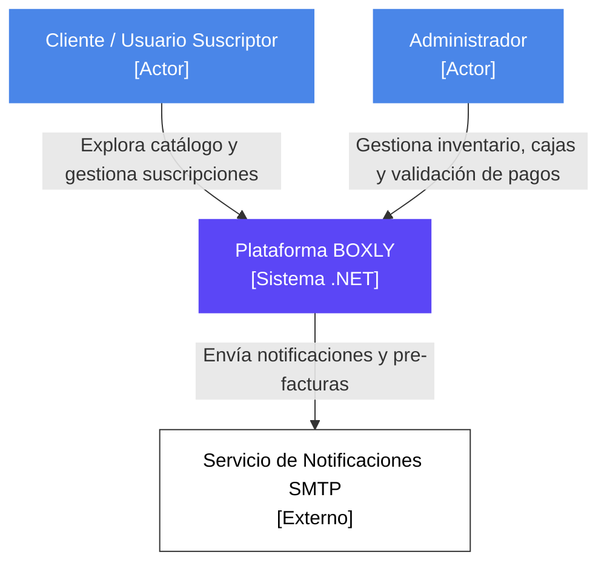
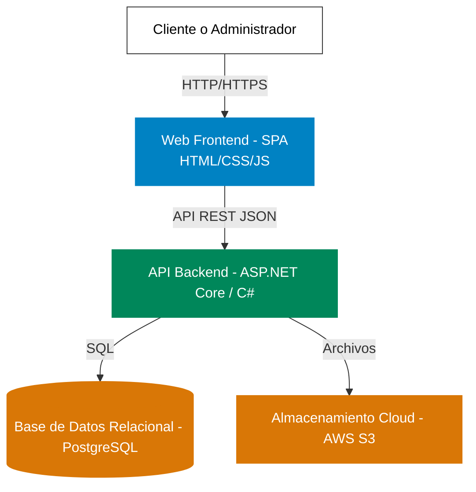
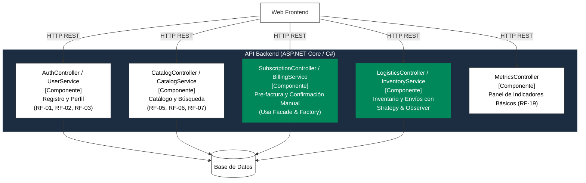
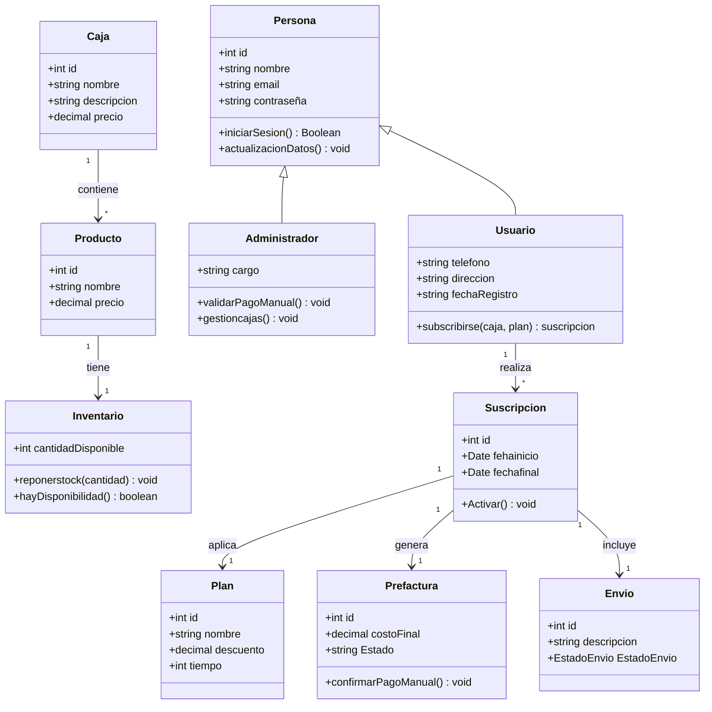

# ProyectoBoxly

Prototipo funcional de **Boxly**, plataforma SaaS de gestión y contratación de cajas de suscripción temáticas (Gaming, Fitness, Cuidado Personal, Tecnología). Desarrollado para el curso de **Diseño de Sistemas de Información** del Instituto Tecnológico de Medellín (ITM) — Entregable No. 2.

## Cómo ejecutar el prototipo

No requiere instalación ni compilación. Abre `inicio.html` en cualquier navegador moderno (o ejecuta el proyecto mediante **Live Server** en VS Code) y navega el Happy Path:

1. **`inicio.html`** — Catálogo general con filtros por categoría (HU-1.1, HU-1.2).
2. **`detalle.html`** — Detalle de la caja y selección de plan Mensual / Semestral (−10 %) / Anual (−20 %) (HU-1.3).
3. **`facturacion.html`** — Dirección de envío, método de pago y pre-factura con desglose plan + envío = total (HU-3.1, RN-03).
4. **`cajas.html`** — Panel «Mis cajas»: la suscripción confirmada aparece como **Activa**.
5. **`configuracion.html`** — Sección de configuración de cuenta: gestión de datos personales (RF-03), selección de intereses y preferencias (RF-04), visualización de métricas de usuario y función para **cerrar sesión** con redirección a `login.html`.

Páginas complementarias: `registro.html` (HU-2.1), `login.html` (HU-2.2), `bonos.html` (programa de recompensas).

## Estructura del repositorio

| Archivo / carpeta | Descripción |
| --- | --- |
| `inicio.html`, `detalle.html`, `facturacion.html`, `cajas.html` | Flujo principal del MVP |
| `configuracion.html` | Configuración de perfil, preferencias, estadísticas y cierre de sesión (RF-03, RF-04) |
| `registro.html`, `login.html` | Autenticación y acceso al sistema (RN-01) |
| `bonos.html` + `bonos_1.jpeg`, `bonos_2.jpeg` | Programa de bonos y recompensas |
| `estilos.css`, `script.js` | Estilos compartidos, paleta de colores corporativa y lógica del prototipo |
| `diagramas/` | Diagramas de actividades del MVP (`.drawio` editables + `.svg`) |
| `Arquitectura C4.md` | Documento técnico del Entregable No. 2 |
| `Entregable_1.pdf`, `Entregable_2.pdf` | Entregables del curso |

## Diagramas C4 
A continuación se presentan los diagramas arquitectónicos de la plataforma de suscripción de cajas Boxly, estructurados según los cuatro niveles del Modelo C4.

## C1: Nivel 1 - Diagrama de Contexto

Este nivel muestra la plataforma Boxly como una caja negra y cómo interactúa con sus usuarios principales (Cliente y Administrador) y con los sistemas externos (Servicio SMTP).

---

## C2: Nivel 2 - Diagrama de Contenedores

Este nivel abre la "caja negra" del sistema Boxly para mostrar los contenedores de software de alto nivel (Frontend, Backend, Bases de Datos) y cómo se comunican entre sí.

---

## C3: Nivel 3 - Diagrama de Componentes

Este nivel hace "zoom" dentro del contenedor de la **API Backend** para mostrar sus bloques de construcción (controladores y servicios) y sus responsabilidades respecto a los requisitos funcionales.

---

## C4: Nivel 4 - Diagrama de Código (Clases)

Este nivel representa el modelo de datos interno y la estructura de clases principal del sistema. En este caso, se ilustra mediante un Diagrama de Clases UML enfocado en el dominio principal de la aplicación.

## Reglas de negocio y requisitos visibles en el prototipo

- **RN-01:** Se requiere cuenta e inicio de sesión para adquirir un plan y gestionar la configuración.
- **RN-03:** La pre-factura incluye valor del plan + costo de envío + total.
- **RN-04:** La suscripción se activa tras registrar el pago.
- **RN-11:** Planes mensual, semestral y anual con descuento progresivo.

## Enlaces

- Repositorio: [https://github.com/AndresFelipeOrozcoPaternina/ProyectoBoxly](https://github.com/AndresFelipeOrozcoPaternina/ProyectoBoxly)
- Prototipo Figma: [https://www.figma.com/community/file/1676053533736794296](https://www.figma.com/community/file/1676053533736794296)

## Equipo

Andrés Felipe Orozco Paternina · Jose Manuel Pulgarin Rueda · Juan David Restrepo Alvarez · Jesús David Ávila Arrieta

Docente: Alexandra Guerrero Bocanegra — ITM, octubre de 2026.
